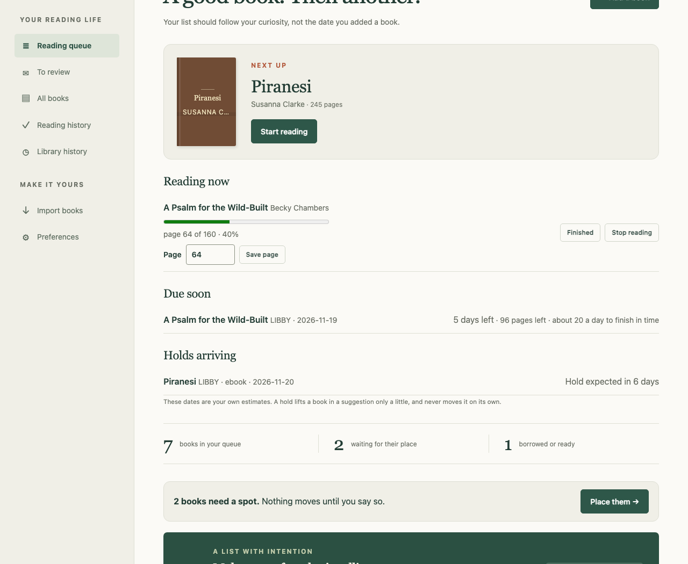
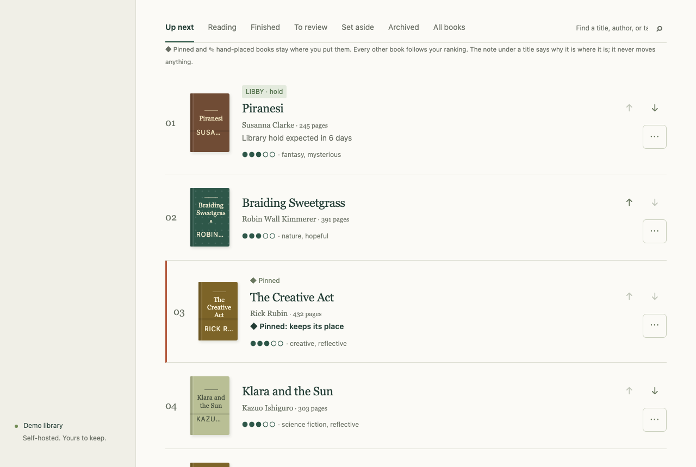
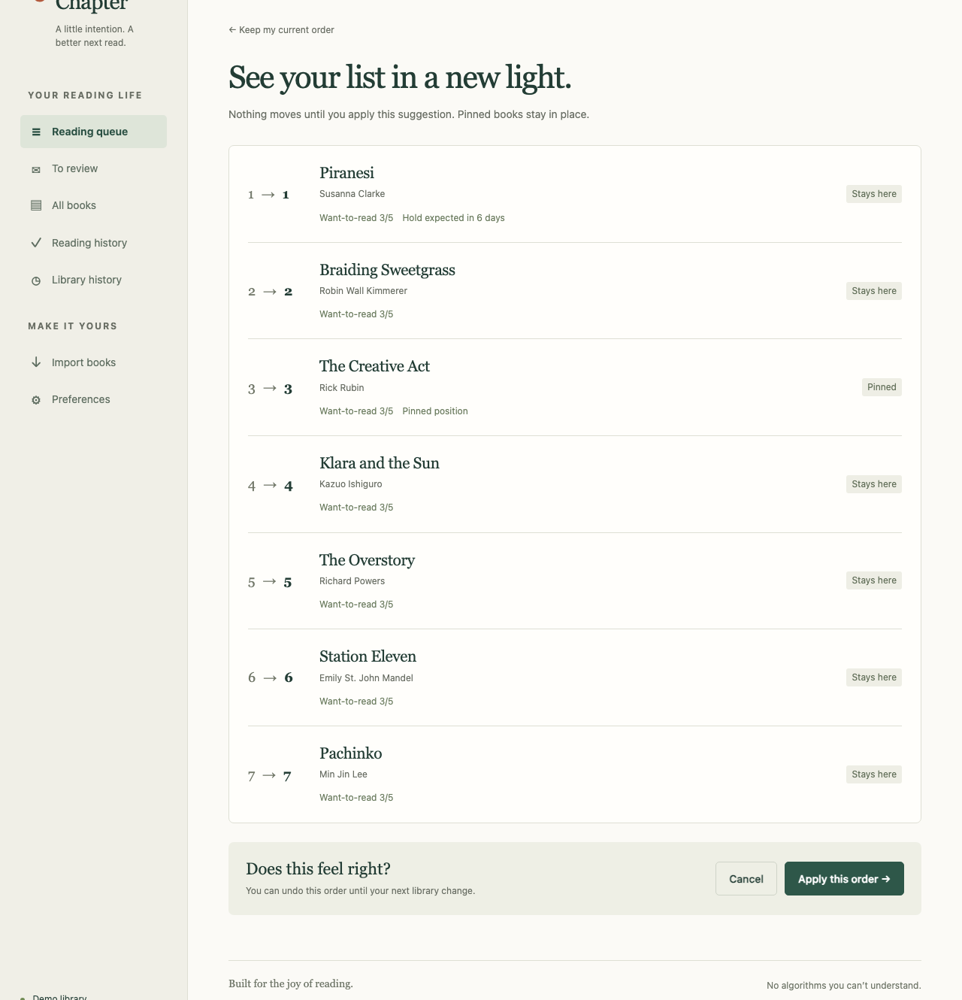
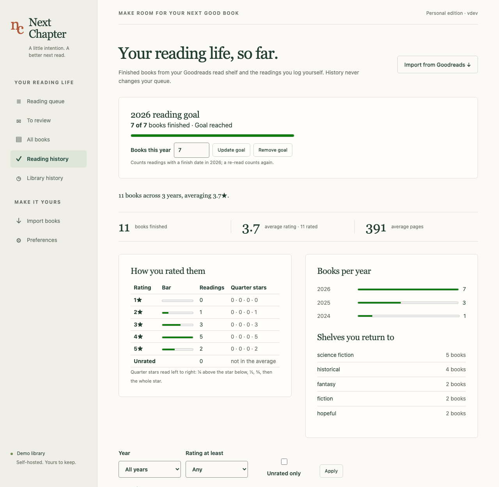
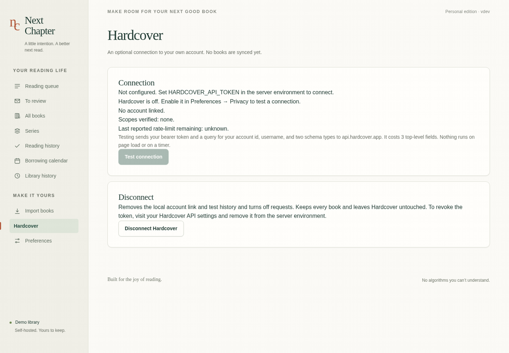
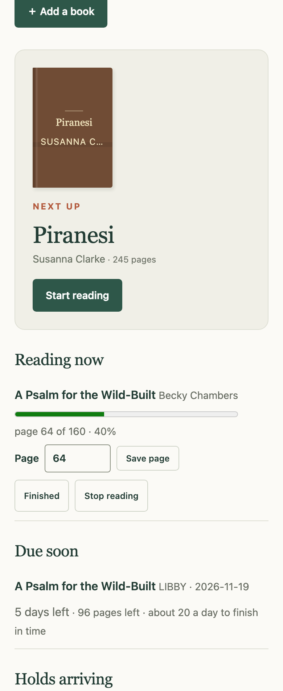
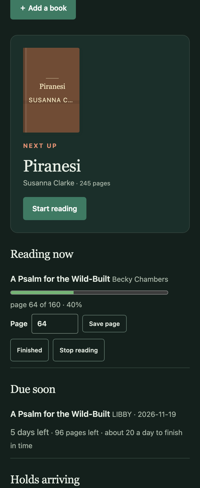
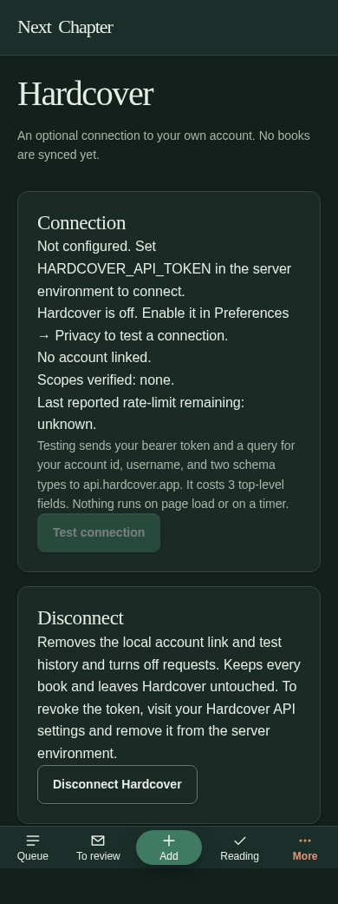

# Next Chapter

A self-hosted reading queue that makes room for a new book where it belongs—not just at the bottom.

Next Chapter is a **single-reader web app** with two ways to organize your list:

- **Find its place:** suggest where one book belongs, preserving the relative order of every other book.
- **Rethink my queue:** reconsider the entire queue using your want-to-read, library timing, preferred length, tags, and series order.

Every suggestion has a preview and reasons. Pinned books keep their positions. You decide whether to apply a suggestion, and can undo it until another library change occurs. No AI service, API key, or subscription is required, and [book lookup](#book-details-lookup-optional) is off unless you switch it on; [AI assistance](#ai-assistance-optional) is off unless you connect a hosted model with your own key or a model on your own hardware, and switch it on; the [Hardcover](#hardcover-optional) connection is off unless you give the server a token and switch it on.

<p align="center">
  <picture>
    <source media="(prefers-color-scheme: dark)" srcset="docs/preview-dark.png">
    
  </picture>
</p>

## What it does

- Add and edit books; move them manually, one place at a time or straight to a queue number (type 3 to make it #3; the books in between shift by one); pin positions; mark reading, finished, abandoned, or archived. A manual move never crosses a pinned book.
- Separate views for Up next, Reading, Finished, To review, Set aside (abandoned), Archived, and All books. Lists show 50 books per page (`per_page` up to 200); queue numbers always count from the top of the whole queue, and a page past the end shows the last page.
- A home screen with **Next up** (the first queued book that is not waiting for placement), **Reading now**, and **Due soon** (borrowed library books due within a week; a loan never changes reading status). Starting or stopping a book moves only that book; **Finished** logs one reading with a quarter-star rating.
- Each queued book can show one short reason for its place (a library deadline, the next book in a series, a mood or length match, or that you pinned or moved it). Reasons only explain; they never reorder.
- Moves, pins, Keep here, and starting, stopping, or re-queuing a book say exactly what happened and offer **Undo** until your next library change.
- **Preferences** are grouped into Ranking, Privacy, and AI assistance, each saved on its own.
- **Placement sessions**: a banner shows how many new books need a spot and opens `/place`, which takes one book at a time, shows the suggested slot with its neighbors and reasons, and offers Put it here, Keep it at the end, or Decide later. Putting it here uses the same plan, revision check, and Undo as a normal suggestion.
- Light and dark themes (follows your system), a status filter and sort on All books, and pages that return you to the book you just changed.
- Phone-friendly: a bottom tab bar, a per-row action sheet in the queue, and a quarter-star rating control. On a phone, use your browser's Add to Home Screen to open it like an app (no offline mode and no service worker).
- Delete a book, or merge a duplicate into the entry you keep, each after a confirmation preview. Re-imports never bring them back.
- Explainable placement and full-queue reordering, with preview, stale-preview protection, and undo. With AI assistance on, a suggestion can also show an AI-suggested order beside the usual one. Every AI request shows what it shares (and, if you want, the exact prompt) before it is sent, and runs in the background while you keep using the app.
- **Reading progress**: save the page you are on, a percentage, or an audiobook position in hours:minutes:seconds (for example, `2:30:15`) or hours:minutes (`2:30`). Home shows how far along you are, and Due soon and the borrowing calendar show what is left and how much a day finishes it before a loan is due. Audiobooks with a total duration show remaining audio and minutes per day; percentage tracking still works without a duration. Progress never moves a book.
- **Expected holds**: enter when you expect a library hold to be ready. As that date nears, the book is lifted a little in suggestions (with a reason), and home lists holds arriving soon. The date is your own estimate; nothing is read from Libby.
- **Private notes**: an optional "why I want to read this" on each book, plus dated notes you write about it, for any reading status. They are plain text (up to 500 characters for the reason, 5,000 for a note, 200 notes a book), stay on your server unless you explicitly share an individual note to Hardcover, and are never imported, looked up, ranked, or sent to an AI. See [Private notes](#private-notes).
- **Saved library views**: filter All books by exact tag, series, page range (or pages unknown), current borrowing source, format, and status, and ownership, then save the filter and sort under a name. See [Saved views and ownership](#saved-views-and-ownership).
- **Series dashboard**: the books you already have, grouped by series name, in number order, with the next known unread volume. See [Series dashboard](#series-dashboard).
- **Borrowing calendar**: due dates, pickup deadlines, and your own hold estimates in one agenda, with an optional one-time `.ics` download. See [Borrowing calendar](#borrowing-calendar).
- **Progress history and pace** (optional, off by default): dated progress updates for each reading attempt, a rough pace, and an approximate finish date. See [Progress history and pace](#progress-history-and-pace).
- **Import reconciliation**: record-by-record import details, corrections to library events, and a list of remembered merges and deletions. See [Import details, corrections, and remembered records](#import-details-corrections-and-remembered-records).
- **Hardcover** (optional, off by default): link books to your Hardcover account, then pull your library, send status, ratings, progress and read dates, fill details and complete series, and check for changes in both directions. Every step is a button you press, with a preview. See [Hardcover](#hardcover-optional).
- **Yearly reading goal**: set a target on Reading history and see whether you are ahead, on, or behind pace. It only measures.
- Goodreads CSV imports that keep your `to-read` shelf order and are safe to repeat: export again from Goodreads whenever you want to bring in new books.
- **Estimated ratings**: “what might I give this?” for an unread book, from your own ratings, with an optional AI second opinion and a running check of how accurate past estimates were.
- A **Reading history** of finished books, with finish dates, your ratings, books per year, and favorite shelves, from your Goodreads read shelf and readings you log yourself.
- **Book details** (optional, off by default): a description, plus pages, year, series, and tags, filled in from Open Library or Google Books when you ask, one book or one import at a time. See [Book details lookup](#book-details-lookup-optional).
- Libby timeline CSV imports and a standard CSV format for physical NYPL activity.
- Separate library events for print, ebook, and audiobook; newest known event wins, regardless of import order.
- Repeatable imports, matching by Goodreads ID, ISBN, then normalized title and author.
- Library-only titles enter **unreviewed**, never automatically finished or added to your reading queue. They wait in **To review** (with a count in the sidebar), where one click marks each as Want to read, Already read, or Not interested. The same view also includes queued books marked **Needs placement**, whether added manually or imported. Want to read keeps a book in To review until you find its place or choose Keep here. Bulk reading decisions affect only undecided books, after a confirmation preview.
- Password login, CSRF protection, local SQLite persistence, JSON export and restore, and consistent SQLite backups.
- Docker, Compose, Kubernetes manifests, automated tests, and tagged multi-platform image publishing.

## A look around

Every screenshot here uses made-up example data. Light and dark themes follow your system.

**Your queue explains itself.** Each book can show one short reason for its place, and pinned or hand-placed books say so. Reasons only explain; they never reorder.



**Suggestions are a preview, not a decision.** Rethinking the queue shows every book's old and new place with its reasons. Nothing moves until you apply it, and you can undo it until your next library change.



**Your reading life, and a goal that only measures.** Finished books from Goodreads and the readings you log, with a yearly goal that tells you plainly whether you are ahead, on, or behind pace.



**Hardcover, only when you ask.** One page holds the connection, the sync switches, and a "Check for changes" button that sorts differences into what Hardcover is ahead on, what is local, and what both changed. Nothing moves until you preview and confirm it.



**Phone friendly.** A bottom tab bar and larger touch targets. Use your browser's Add to Home Screen to open it like an app.

<p>
  
  
  
</p>

## Integration boundaries

**This app owns the ordered queue. It does not write order, reading status, ratings, reviews, or reading history back to Goodreads.** Goodreads stopped issuing public API keys; this project does not depend on that API or request a Goodreads password.

Goodreads turned off its public shelf feeds in 2026, so CSV import is the only Goodreads path. [Hardcover](#hardcover-optional) is an optional alternative that has a real API: it can pull your library without a CSV round trip, and, unlike Goodreads, accept status and ratings back. Export your library from Goodreads (My Books → Import and export → Export Library) and import the file as often as you like. Each export is matched against what you already have: by ISBN when the row has one, otherwise by normalized title and author, and by Goodreads Book ID as a last resort for a book whose title or author you edited. Books you deleted stay deleted, and merged books update their target. New books are appended, oldest first, and marked **Needs placement**; imports never silently reorder your queue.

A CSV import makes no network requests: the file you upload is the only input, and nothing is sent to Goodreads. The optional exceptions are [book lookup](#book-details-lookup-optional) and [Hardcover](#hardcover-optional), both off by default and run only when you press a button.

Libby supports exporting timeline activity but does not provide a direct Goodreads integration. Export column names and activity labels can vary. The parser accepts common variants and rejects unsupported rows with an actionable error; normalize those rows to the provided sample CSV before importing. There is no authenticated Libby connection.

**NYPL physical history is not a live connection.** The `examples/nypl.csv` format is an app-defined template, not an official NYPL export. Capture current checkouts and holds from your account, or reconstruct records from receipts you already have. NYPL says physical loan records are normally deleted soon after return, so old history cannot be assumed recoverable. An event disappearing from a snapshot is never inferred to be a return or cancellation. No automatic NYPL account or email scraping is included.

Authoritative references:
- [Goodreads API notice](https://www.goodreads.com/group/show/8095-goodreads-developers)
- [Libby export instructions](https://help.libbyapp.com/en-us/6207.htm)
- [Libby / Goodreads integration limitations](https://help.libbyapp.com/en-us/6211.htm)
- [NYPL privacy policy, circulation records](https://www.nypl.org/help/about-nypl/legal-notices/privacy-policy)

## Run with Docker Compose

Requirements: Docker Engine with Compose.

```sh
cp .env.example .env
# Generate two independent secrets and put them in .env:
openssl rand -hex 32
openssl rand -hex 32
# Set APP_PASSWORD to the first value, APP_SECRET_KEY to the second.
docker compose up --build -d
```

Open [localhost:8000](http://localhost:8000) and sign in with `APP_PASSWORD`. Your data is stored in the named `library` volume. Optional AI assistance, including a local Ollama service under the `ollama` profile, is described in [AI with Docker Compose](#ai-with-docker-compose). Startup fails unless the password is at least 12 characters and the signing key at least 32. `.env` is ignored by Git and excluded from the image.

Compose binds to loopback by default. For access from other devices, place the app behind your HTTPS reverse proxy and set `COOKIE_SECURE=1`, which also sends `Strict-Transport-Security`. Configure the proxy to reach container port 8000 and preserve the host. Keep the app password enabled. Do not publish unauthenticated demo mode.

**Behind a proxy, set `TRUSTED_PROXY_HOPS`.** Failed sign-ins are limited per client address (10 per minute), with a backstop of 100 failures per minute across all clients. By default the client address is the TCP peer and `X-Forwarded-For` is ignored, so it cannot be spoofed. Behind a reverse proxy every request comes from the proxy's address, so all visitors share one limit and one person's typos can lock out everyone for a minute. Set `TRUSTED_PROXY_HOPS` to the number of proxies that append to `X-Forwarded-For` (usually `1`); the app then takes that entry counting from the right, ignoring anything a client prepended. Only set it when every request really passes through that many proxies, or clients can choose their own address.

Sign out on one browser with **Sign out**. **Sign out everywhere** in Preferences ends every session on every device. Changing `APP_PASSWORD` or `APP_SECRET_KEY` also ends every session. When a server error occurs, the page shows a short reference that matches a `request_id=` line in the container log.

The image runs as UID/GID `10001:10001`, with a read-only root filesystem, writable `/tmp`, and persistent `/data`. One Go process serves requests. Use one container/replica per database; SQLite storage should be on a local/block filesystem rather than a shared network filesystem.

### Build or run without Compose

```sh
docker build -t next-chapter:local .
docker run -d --name next-chapter \
  --env-file .env \
  -p 127.0.0.1:8000:8000 \
  -v next-chapter-data:/data \
  --read-only --tmpfs /tmp:mode=1777,size=64m \
  --cap-drop ALL --security-opt no-new-privileges:true \
  next-chapter:local
```

To use an Ollama running on the same computer with `docker run`, add `--add-host=host.docker.internal:host-gateway` and set `AI_BASE_URL=http://host.docker.internal:11434` in `.env` (see [Self-hosted models](#self-hosted-models-ollama-and-openai-compatible-servers)).

The published Go image is `ghcr.io/lafronzt/next-chapter:0.2.0` (also `:latest`), supporting `linux/amd64` and `linux/arm64`. A release tag triggers the included GitHub workflow. Prefer a version tag or digest in production. The final image contains a statically compiled Go executable and CA certificates, with no interpreter or shell. Rebuild with `docker build --pull` to refresh the Go toolchain.

```sh
docker pull ghcr.io/lafronzt/next-chapter:0.2.0
```

### Upgrade from v0.1

Download a database backup, stop the old container, and start v0.2 with the same data volume and environment settings. The Go version preserves books, queue order, preferences, and borrowing history. Sign in again after upgrading.

**The first start makes a one-way change.** Schema migration 2 rewrites every event and loan timestamp into a canonical format and clears pending previews and the last undo. Before it runs, the app writes `next-chapter.sqlite3.pre-v2.bak` next to the database (see [Backup and restore](#backup-and-restore)). Never run the v0.1 Python image against the migrated file. To roll back, restore the `.bak` as described below and run v0.1 against that.

## Kubernetes

Use a cluster with a default StorageClass and a local/block-backed persistent volume. The plain manifest intentionally uses **one replica** and **Recreate** updates to avoid overlapping SQLite writers; upgrades have brief downtime.

1. Build and push your image, or publish a release tag with the included GitHub workflow.
2. Replace the image in `deploy/kubernetes/app.yaml` with your registry image and version.
3. Create the secret from the same `.env` file, apply the manifest, and port-forward:

```sh
kubectl create secret generic next-chapter-auth --from-env-file=.env
kubectl apply -f deploy/kubernetes/app.yaml
kubectl port-forward service/next-chapter 8000:80
```

### Helm

`deploy/helm/next-chapter` is a chart with the same hardening (one replica, non-root) plus an optional cert-manager Ingress. Unlike the plain manifest, the chart uses a `RollingUpdate` strategy with `maxUnavailable: 0` and `maxSurge: 1`, so an upgrade starts the new pod before the old one stops and the two briefly share the database volume. That keeps the app available during upgrades but is a deliberate trade against the single-writer rule above: it needs a volume both pods can mount (`ReadWriteMany`, or the same node), and you should back up before a release that migrates the schema. Set options in a values file or with `--set`; see `values.yaml` for all of them.

```sh
helm upgrade --install next-chapter deploy/helm/next-chapter \
  -n next-chapter --create-namespace \
  --set auth.password="$(openssl rand -hex 32)" \
  --set ingress.host=next-chapter.example.com \
  --set ai.provider=ollama --set ai.model=llama3.1:8b \
  --set ai.baseUrl=http://ollama.<namespace>.svc.cluster.local:11434
```

`auth.secretKey` is generated once and kept across upgrades. Use `auth.existingSecret` to supply your own Secret instead, and `env.*` for any other app setting. The data PVC is kept on `helm uninstall`.

#### Automatic upgrades from releases

Pushing a `v*` tag publishes the image and then runs `helm upgrade` from the `deploy` job in `.github/workflows/publish.yml`, setting only `image.tag` (`--reuse-values --rollback-on-failure`). Release candidates (`v1.2.3-rc1`) are published but not deployed. The job runs on a self-hosted runner (`runs-on: self-hosted`; keep this repository's self-hosted runners limited to ones that can deploy), which may live in a different cluster as long as it can reach this cluster's API server. It authenticates with a kubeconfig stored as the `KUBE_CONFIG` secret on the `production` environment (Settings > Environments). The deploy job installs a pinned, checksum-verified `helm` itself (ARC runner images do not include it), so the runner only needs outbound access to `get.helm.sh`.

One-time setup, against the cluster that runs next-chapter:

```sh
kubectl apply -f deploy/kubernetes/runner-rbac.yaml   # service account + namespaced Role
SERVER=https://<api-server-address>:6443
TOKEN=$(kubectl -n next-chapter get secret github-deployer-token -o jsonpath='{.data.token}' | base64 -d)
CA=$(kubectl -n next-chapter get secret github-deployer-token -o jsonpath='{.data.ca\.crt}')
cat > kubeconfig <<KUBE
apiVersion: v1
kind: Config
clusters: [{name: next-chapter, cluster: {server: $SERVER, certificate-authority-data: $CA}}]
users: [{name: github-deployer, user: {token: $TOKEN}}]
contexts: [{name: next-chapter, context: {cluster: next-chapter, user: github-deployer, namespace: next-chapter}}]
current-context: next-chapter
KUBE
gh secret set KUBE_CONFIG --env production < kubeconfig && rm kubeconfig
```

The service account can only manage the `next-chapter` namespace. Never commit the kubeconfig.

`--rollback-on-failure` rolls the pod back if the new version never becomes ready, but it does not undo a SQLite schema migration. Back up the data volume before releasing a version that migrates (see [Schema upgrades and rollback](#schema-upgrades-and-rollback)).

For optional AI assistance, see [AI on Kubernetes](#ai-on-kubernetes); `deploy/kubernetes/ollama.yaml` runs a private Ollama server in the cluster if you want local models.

The PVC defaults to 1 GiB. The manifest includes resource limits, readiness/liveness checks, a non-root user, dropped capabilities, and a writable temporary directory. `/healthz` is unauthenticated and returns only a health status.

For an HTTPS Ingress, configure your preferred controller and certificate, then set `COOKIE_SECURE` to `"1"` in the deployment. The example leaves it at `"0"` for HTTP loopback port-forwarding. Avoid setting conflicting values in both the secret and deployment; the explicit deployment value wins.

Kubernetes manifests are supplied as deployment templates. You must choose your storage class, ingress, TLS certificate, namespace, image pull access, and backup destination. No cluster is modified by this repository.

## Ranking behavior

Each queued book starts with `want-to-read × 10` points (10–50). Additional points:

| Signal | Points |
| --- | ---: |
| Ready for pickup | 25 |
| Already borrowed | 15 |
| Available | 5 |
| Loan / pickup deadline within 7 days, including overdue | +20 |
| Hold you expect to be ready within 14 days (your own estimate) | 10 |
| Exact mood tag match, case-insensitive | 15 |
| Preferred length match (≤250 or ≥400 pages) | 10 |
| Saved estimated rating, only if turned on in Preferences | −10 to +10 |

Only the strongest library signal is used per book; multiple formats do not stack. Library points are multiplied by the selected timing weight (0, 0.5, 1, or 2). All dates used for ranking use UTC. A hold counts only if you entered a date you expect it to be ready, and only within 14 days of it; a request alone does not imply availability, so a hold with no date gets no boost.

Full-queue suggestions sort by score while respecting pins and earlier queued books in the same series. Equal scores preserve existing order. Series metadata is supplied by the reader; the Goodreads export does not reliably provide it. Insertion finds the earliest lower-scoring book, then the closest feasible slot that preserves the other books' order, pin slots, and the candidate's series dependencies. Impossible constraints produce a clear error instead of silently moving pins. Manual moves are intentional overrides of ranking; pin crossings must be unpinned first. **Move to #** takes a queue number counted from the top of the whole queue (on every page): the book lands there, the books between its old and new place shift by one, and everything else keeps its order. A number outside 1 to the queue length, or a move that would cross or displace a pinned book, is refused with a message and changes nothing.

A book you move with the arrows or **Move to #** is marked **Moved by hand**. The mark is a signal, not a constraint: the usual ranking still sorts by score and lists "You moved this by hand" among the book's reasons, and an AI suggestion is told the book is where you put it and to keep it near there unless your note says otherwise. Applying a suggested order clears the marks (placing one book clears only that book's), and undo restores them.

Preferences affect the next suggestion; saving them does not move books. Reading/finished/archived/unreviewed books are outside the queue. Returning a book never changes its reading status.

## Estimated ratings

On a queued book (**Predict my rating**) or a book's page, Next Chapter estimates the rating you might give a book you have not rated yet, from the ratings you gave other books. It is an aid for deciding, not a fact, and it can be wrong.

**The baseline needs no AI.** It starts from your average rating, then mixes in your averages for rated books by the same author, in the same series, and sharing any of its tags, each weighted by how many books it covers, and the Goodreads average, which counts like a single book because it is other readers' opinion:

```
(3 × your average + Σ books × average for author / series / shared tags + 1 × Goodreads average) ÷ (3 + Σ books + 1)
```

The page shows the result to one decimal, "Based on N rated books", and each factor. With fewer than 10 rated books it is labelled low confidence. Each book counts its latest rated reading; the candidate's own readings never count. A book you have already rated gets no estimate.

**An AI second opinion is optional.** With AI assistance on, the estimate page lists exactly what would be sent: the candidate's title, author, tags, pages, series, description (up to 1,000 characters), Goodreads average, and baseline; your rating statistics; and at most 40 of your rated books (your 10 highest- and 10 lowest-rated, then those closest by tags, author, and series), each with title, author, tags, pages, series, description (up to 400 characters), your rating, and finish year. Descriptions are the ones stored with the books, from you or from [book lookup](#book-details-lookup-optional); a book without one sends none. Changing a description makes a saved AI estimate stale, since the request would differ. Review text is sent only if you keep reviews and tick the box for that request. Nothing else goes: no ISBNs, Goodreads IDs, loans, or library accounts. **Show the exact prompt** opens the full request word for word. The answer must be JSON with an estimate from 1 to 5, a confidence of low, medium, or high, and one to three short reasons; anything else is discarded. It is shown next to the baseline, labelled AI-generated, and never replaces it.

**Saved, not live.** Estimates are saved (in `rating_estimates`) with a fingerprint of their inputs and shown without contacting any provider. When your rated history or the book changes, the page marks the saved estimate as possibly out of date and offers to update it. Estimating never changes your library or its revision, and estimates are a cache: they are not in the JSON export and are dropped when the book is deleted.

**Ranking, only if you want.** Preferences has **Let my saved estimated ratings nudge suggestions**, off by default. When on, a saved estimate adds `(estimate − 3) × 5` points (−10 to +10), shown as a reason such as "Estimated 4.3★ for you". It uses the AI value when there is one, otherwise the baseline, and the saved value even if it is out of date; ranking never calls a provider. Books without an estimate are ranked exactly as before.

**How accurate was I?** When you rate a book that had an estimate, Reading history shows the average error of the baseline and of the AI estimates, in stars, and how many were within half a star. The book's page shows its estimate next to your rating.

## AI assistance (optional)

Next Chapter works fully without AI. If you want suggestions from a language model, you can connect:

- **A hosted model** from Anthropic (Claude) or OpenAI with your own API key. You pay the provider directly.
- **A model on your own hardware** with [Ollama](https://ollama.com), so nothing leaves your machine or network.
- **Any other model** behind an OpenAI-compatible server, such as LM Studio, vLLM, llama.cpp's server, LocalAI, or a gateway you run.

There is no hosted proxy and no paid service from this project.

It is **off by default** and needs two steps:

1. **The operator** sets a provider and model in the environment (plus a key for hosted providers) and restarts the app:

   | Variable | Meaning |
   | --- | --- |
   | `AI_PROVIDER` | `off` (default), `anthropic`, `openai`, `ollama`, or `custom` |
   | `AI_MODEL` | The model name, required. Hosted suggestions checked on 2026-10-13: `claude-opus-5-5` for Anthropic, `gpt-6-astra` for OpenAI; a cheaper model costs less per request. For `ollama`, any model you have pulled, such as `llama3.1:8b` or `qwen2.5:7b`. For `custom`, the model name your server lists. |
   | `AI_API_KEY` | Required for `anthropic` and `openai` (`ANTHROPIC_API_KEY` or `OPENAI_API_KEY` also work outside Compose). Optional for `ollama` and `custom`, which send it as a bearer token when set, for a server behind an authenticating proxy. |
   | `AI_BASE_URL` | For `ollama`, the server address, default `http://127.0.0.1:11434`. For `custom`, required: the OpenAI-compatible API root, usually ending in `/v1`, such as `http://127.0.0.1:1234/v1`. Plain `http://` is accepted only for servers on this machine or a private network (see below); anything else needs `https://`. For `anthropic` and `openai` it exists only for tests and accepts nothing but `https://127.0.0.1:<port>`. |
   | `AI_TIMEOUT_SECONDS` | How long to wait for one answer, 5 to 600, default `60`. Raise it for slow local models. |
   | `AI_MAX_MONTHLY_REQUESTS` | Requests allowed per calendar month (UTC), default `100`. Local models cost nothing per request, so raise it freely there. |

   The app refuses to start if the provider is missing something it needs: a model, a key for hosted providers, a base URL for `custom`, or HTTPS for a server outside your network.

2. **The reader** turns on **AI assistance** in Preferences. Preferences shows the provider, model, and (for self-hosted servers) the server address and whether it is on your network, this month's requests and tokens, a plain-language summary of what is shared, and a **Test connection** button that sends a fixed prompt with no library data.

**What is sent, and when.** Only an AI action you start sends anything: never on a schedule, during an import, or when a page loads. Each AI action first shows a **What gets shared** list of the exact rows and fields it will send, and sends only after you confirm. **Show the exact prompt** under that list is optional: it opens the instructions, the message with your data, and the required answer format word for word as the provider receives them. Requests carry only what the task needs: titles, authors, tags, page counts, series, want-to-read, your ratings and estimated ratings, finish dates, queue positions, whether a book is borrowed or ready for pickup and the days to its deadline, and any note you write for that request. They never carry library-card or loan account details, your password or session, ISBNs, Goodreads IDs, or review text (unless you keep reviews and tick a box for that one request). With a hosted provider, its data terms apply; OpenAI requests ask it not to store the response (`store: false`). With a self-hosted server, whoever runs that server can see what is sent.

**While the AI answers.** Once you confirm, the request runs in the background, one at a time; asking for another while one runs says so. You see a waiting page that checks again every few seconds and opens the result when it arrives, but you can leave it and keep using the app: a note at the top of every page says the AI is working and, once it finishes, links to the answer or the error. If you change what a request depends on meanwhile (your library for a queue suggestion; your ratings or that book for an estimate), its answer is not saved and you can ask again. Requests live in memory, so restarting the app cancels one in progress.

**Safety rails.**

- Hosted requests go only to `https://api.anthropic.com/v1/messages` or `https://api.openai.com/v1/responses`. Self-hosted requests go only to the configured `AI_BASE_URL`, at `/api/chat` for Ollama or `/chat/completions` under the API root for `custom`. Plain `http://` is accepted only when the host is `localhost`, a loopback, private (10.x, 172.16-31.x, 192.168.x, fc00::/7), or link-local IP address, a single-word name such as a Compose service (`ollama`), or a name ending in `.local`, `.lan`, `.internal`, `.home.arpa`, or `.svc`. A URL with a username, password, query, or fragment is refused.
- Every request has the configured timeout, a 1 MB response limit, no redirects, and `User-Agent: NextChapter/<version>`. Only `net/http` is used; there is no vendor SDK.
- The key is read from the environment only. It is never stored in the database, exports, or backups, never shown on a page, and never logged. Logs record only a failure class such as `status-429` or `timeout`, never prompts, answers, or provider error bodies.
- One AI request runs at a time, and never while holding the database: inputs are read first, the provider is called, then a short write saves the result. Every attempt, including failed ones, counts toward the monthly limit; when it is used up, AI actions say so until the next month.
- Model output is untrusted. The app asks for JSON matching a schema, then decodes it strictly (unknown fields are an error) and checks every value: IDs must be ones it sent, with no repeats, and numbers must be in range. Anything else is discarded with a plain message. An answer can only propose; it never writes to your library directly.
- Book data comes from imported files, so it is sent inside a delimited data block, and the model is told to treat it as data, not instructions. The schema check above is the real defence.

To turn AI off again, switch it off in Preferences, or set `AI_PROVIDER=off` (or remove it) and restart.

### AI-suggested order

Your usual ranking stays the default. With AI assistance on, **Rethink my queue** has an optional note for the AI ("something light after a heavy book; a long flight Friday"), and every queue suggestion (**Rethink my queue** or **Find its place**) offers **Ask the AI for a second opinion** below the usual preview. That section lists exactly what would be sent; nothing goes until you press **Send and suggest**.

- **What is sent.** For a full reorder: the 60 highest-scoring books in your queue plus up to 40 pinned books and up to 40 books you moved by hand. For placing one book: the book and up to 60 books around its usual place, limited to positions that keep pins and series order. Each book has a number used only for this request (not its database or Goodreads ID), title, author, tags, pages, series and number, want-to-read, saved estimated rating if any, library status (only "borrowed" or "ready for pickup" and the days to the deadline; never the library, format, or account), whether it is pinned or moved by hand, and its current position. Also sent: your note, if you wrote one, and your 5 most recently finished books (title, author, tags, your rating, and month). The note is stored only in the suggestion, which expires after an hour.
- **What comes back.** For a reorder, every number exactly once and optional short reasons; for placing, one position from the offered range and a reason. Unknown, missing, or repeated numbers, extra fields, or reasons over 200 characters discard the answer: the page then says so plainly and shows only your usual ranking.
- **Rules still win.** The AI's order replaces the score only as the sort key. The same solver as the usual ranking keeps pinned books in their slots and earlier series books first, moving as few books as it must; those books are marked "Moved from the AI's order to keep pins and series order". Books that were not sent keep their relative order after the ones that were. A placement must fall within the valid range, or it is discarded.
- **You choose.** The preview switches between **Use my usual ranking** and **Use AI suggestion**, with movement, the usual score reasons, and the AI's reasons labelled AI, plus the model and token use. Applying either uses the same revision check and undo. If your library changes while the AI is answering, the result is not saved and you are asked to generate a fresh suggestion. New Goodreads books still wait in Needs placement; nothing is reordered automatically, on a schedule, or during an import.
- **Cost.** A full reorder of a large queue sends about 13,000 characters (measured on a synthetic 60-book request), roughly 3,500 to 4,500 input tokens. The answer is a few hundred tokens plus any reasoning tokens the model uses, which vary by model. Placing one book costs about the same. Preferences shows the real token counts each month. With Ollama or another self-hosted model there is no per-request charge, but a reorder can take minutes on a CPU or small GPU; set `AI_TIMEOUT_SECONDS` to match. You can keep using the app while it works.

### Self-hosted models: Ollama and OpenAI-compatible servers

Requests to Ollama use its native chat API with a JSON Schema in `format`; requests to a `custom` server use Chat Completions with `response_format` set to a strict JSON schema. Both repeat the schema in the prompt and use temperature 0, which helps smaller models follow it. Self-hosted servers also get length limits in the schema (for example, at most three reasons of at most 240 characters), which their grammar-based decoding enforces while the model writes; without them, a small model can repeat itself until it reaches the token limit. Hosted APIs reject those keywords, so they get the plain schema and the app checks lengths afterwards. The server must support JSON-schema structured output: Ollama does, and so do current LM Studio, vLLM, and llama.cpp servers. A model that ignores the schema produces answers the app discards with a message, never a change. Instruction-tuned models of about 7B parameters or more follow it far more reliably than tiny ones. Small local models give simpler suggestions than large hosted ones. Rating estimates sent to self-hosted servers use up to eight rated books, including high and low ratings and books related to the candidate, with descriptions cut to 160 characters and optional reviews to 240. Overall statistics and the baseline still use the full reading history. The candidate comes after the history in the prompt. This reduces context use but does not guarantee that every request fits your server’s context window; check the exact prompt and Ollama logs if answers seem generic or repeat across books.

Ollama is also OpenAI-compatible, so `AI_PROVIDER=custom` with `AI_BASE_URL=http://127.0.0.1:11434/v1` works too; `ollama` is simpler and needs no path.

Where Ollama runs decides `AI_BASE_URL`:

| Ollama runs… | `AI_BASE_URL` |
| --- | --- |
| On the same computer, app run directly | `http://127.0.0.1:11434` (the default) |
| In the Compose `ollama` profile (below) | `http://ollama:11434` |
| On the computer that runs Docker, outside Docker | `http://host.docker.internal:11434`. Ollama listens only on 127.0.0.1 by default; start it with `OLLAMA_HOST=0.0.0.0` so containers can reach it, and keep port 11434 closed to the internet. |
| On another machine on your network | `http://192.168.1.20:11434` (its address), with `OLLAMA_HOST=0.0.0.0` on that machine |
| In Kubernetes from `deploy/kubernetes/ollama.yaml` | `http://ollama:11434` |
| Anywhere reached over the internet | `https://…` only, ideally behind an authenticating proxy, with `AI_API_KEY` as its bearer token |

Pull the model before switching AI on (`ollama pull llama3.1:8b`); otherwise the test reports that the server does not know the model. A first request after the server starts may be slow while the model loads, so allow for it in `AI_TIMEOUT_SECONDS`.

### AI with Docker Compose

`compose.yaml` passes the `AI_*` variables from `.env` to the app (as `AI_API_KEY`; Compose does not pass the vendor-specific key names). It also defines an optional `ollama` service under a profile, so it only runs when asked:

```sh
# in .env: AI_PROVIDER=ollama, AI_BASE_URL=http://ollama:11434, AI_MODEL=llama3.1:8b
docker compose --profile ollama up -d
docker compose exec ollama ollama pull llama3.1:8b
```

Models are kept in the `ollama` volume. The Ollama port is not published, so only the app can reach it; for GPU acceleration, add your GPU settings to the service as Ollama's Docker instructions describe. For a hosted provider, set `AI_PROVIDER`, `AI_MODEL`, and `AI_API_KEY` in `.env` and run `docker compose up -d` as usual.

### AI on Kubernetes

Keep any key in a Secret, separate from the manifest. The simplest way is to add the `AI_*` lines to the same `.env` you create `next-chapter-auth` from. To keep the AI key in its own Secret instead:

```sh
kubectl create secret generic next-chapter-ai --from-literal=AI_API_KEY='…'
```

Then uncomment the `AI_*` entries you need in `deploy/kubernetes/app.yaml`. Rotating the key means updating the Secret and restarting the pod.

For models in your cluster, `deploy/kubernetes/ollama.yaml` adds a single Ollama Deployment with a 20 GiB volume for models and a cluster-internal Service. Size its memory limit and volume for your models, add a GPU resource limit if you have a device plugin, and pull a model once:

```sh
kubectl apply -f deploy/kubernetes/ollama.yaml
kubectl exec deploy/ollama -- ollama pull llama3.1:8b
```

Then set `AI_PROVIDER=ollama`, `AI_BASE_URL=http://ollama:11434`, `AI_MODEL`, and a longer `AI_TIMEOUT_SECONDS` for the app. Restrict who can reach the Ollama Service with a NetworkPolicy if your cluster is shared.

## Book details lookup (optional)

A Goodreads or library import gives a title, an author, and little else. **Book lookup** can fill in a description, page count, first-publication year, series, and tags from a global book database. It is plain HTTPS and JSON that this app sends itself. No AI is involved and no model decides what is true.

- **Off by default.** Turn it on in Preferences → Privacy (“Book lookup”). Until then nothing is sent anywhere, and the Details block and import preview say so.
- **Only when you ask.** There is no lookup on a timer, page load, or import. You press **Look up details** on one book (or on the **Add a book** form, before the book is added: it fills the empty fields for you to check and saves nothing until you add it), or **Look up details for these N books** on an import preview (up to 25 at a time; press again for the rest).
- **What is sent, and to whom:** the book's **title, author, and ISBN** (when it has one) to [Open Library](https://openlibrary.org/developers/api) and [Google Books](https://developers.google.com/books/docs/v1/using), and to ISBNdb if the operator set a key. Never your ratings, reviews, tags, reading history, or any other book. The requests carry a `NextChapter/<version>` User-Agent and no cookies. Those services see your server's IP address and can log the request.
- **You choose, field by field.** A single-book lookup shows each field with your value and theirs. A field you have not filled is filled with theirs unless you pick **Leave empty**. For a field you have filled, the default is **Keep mine**; you can instead pick **Use theirs** (replaces yours) or, for the description and tags, **Merge both** (their description is added after yours, and tags are joined without repeats). Nothing is saved until you press Save, and nothing you did not choose is replaced. An import preview has one choice for every value a book already has (keep mine, use theirs, or merge), where "mine" is your library or your file; empty fields are always filled. Nothing is saved until you press Import, and importing again changes nothing more. A lookup never moves a book in your queue. Pages, tags, and series it fills are the same fields suggestions read, so a later suggestion can read them; pressing the button never reorders anything.
- **Untrusted text.** Database text can contain anything. It is stored as plain text with markup removed, cut at 2,000 characters, shown escaped, and sent to an AI only inside `<library_data>`. With [AI assistance](#ai-assistance-optional) on, a stored description (up to 1,000 characters) is part of the candidate in an estimate and shows in the exact-prompt preview; adding or changing one makes a saved AI estimate for that book stale. It does not change the reader-history fingerprint.
- **Limits.** Databases can be wrong, out of date, or missing a book. Open Library's series data is sparse, so series usually stays empty. Open Library is asked first and wins where the databases disagree, unless the operator set `GOOGLE_BOOKS_API_KEY`, in which case Google Books goes first. If two books match a title and author, nothing is filled; add an ISBN. Redirects are not followed, replies over 1 MB are refused, and each request times out after 8 seconds.
- **Optional keys (never required):**

  | Variable | Meaning |
  | --- | --- |
  | `GOOGLE_BOOKS_API_KEY` | Raises Google Books' request quota. Works without it. |
  | `ISBNDB_API_KEY` | Adds [ISBNdb](https://isbndb.com/isbn-database) (paid) as a third source for books with an ISBN. |

  WorldCat (OCLC) needs OAuth credentials and is not built into the app; use the external workflow below if you have access.
- **Backups and rollback.** Descriptions are stored in new `books.description` and `books.description_source` columns (schema migration 10, below) and are part of the JSON export, restore, and merge (a merge keeps the surviving book's description, else the merged-away book's). Older exports without them still restore.
- **Deeper research with your own AI agent (outside the app).** For web search and MCP tools, such as Claude Code or Claude Desktop, use [`prompts/external-agent-book-lookup.md`](prompts/external-agent-book-lookup.md). It is optional and separate: the app does not call it, and the agent never writes to your library.

## Imports and data ownership

CSV files must be UTF-8, ≤2 MB, and ≤10,000 rows. A malformed row blocks the entire import, with row numbers shown. Import previews expire after an hour. A library change invalidates prior previews, preventing an old browser tab from overwriting newer work.

- `Title` and `Author` are required for every record.
- Goodreads fields: `Book Id`, `ISBN13` or `ISBN`, `Number of Pages`, `Exclusive Shelf`, `Bookshelves`, `My Rating`, `Date Read`, `My Review`, `Average Rating`, and `Original Publication Year` (or `Year Published`). The bundled sample has every column of a Goodreads export. An unreadable `Date Read` is a row error, like any other bad date; `Date Read` may be blank.
- **Ratings seed want-to-read for new books only.** A `My Rating` of 0.25–5 (Goodreads allows quarter stars) becomes the starting want-to-read of a book the import adds, rounded to the nearest whole star: 4.25 starts at 4, 4.5 at 5. The exact rating is kept in Reading history. Rating forms offer five whole-star shortcuts and an optional exact-rating selector for quarter stars; the native selector also works without JavaScript. `0` or blank means unrated and starts at 3. Any other value, such as `7` or `abc`, is ignored rather than failing the import; the book starts at 3 and the preview says how many ratings were ignored. A book already in your library keeps the want-to-read you set, whatever its Goodreads rating. `Average Rating` is never used: it is other readers' opinion, not yours. Rated books on the `read` shelf are stored as usual; want-to-read only matters if they return to the queue. The preview shows how many new books take their rating and how many existing books keep theirs.
- **Series in the title.** Goodreads writes a series as `Heated Rivalry (Game Changers, #2)`. The import stores the title `Heated Rivalry`, the series `Game Changers`, and the number `2` (decimals like `#0.5` work). A trailing group without a `#number`, such as `(A Novel)`, and ranges like `#1-3` stay in the title. A book you imported earlier under the full title is still matched, not duplicated; if it has no series yet, the series and number are filled in, and anything you set yourself is kept. Suggestions read series order, so an imported series can affect later suggestions; the import itself never reorders your queue.
- Library fields: `Timestamp` (or `Date`), `Activity` (or `Status`), optional `Format`, `ISBN`, and `Due Date`.
- Prefer ISO 8601 timestamps with time zones and `YYYY-MM-DD` due dates. Date-only and timezone-free inputs are treated as UTC. If several different events share the same timestamp and format, the first one imported remains the current status; supply more precise timestamps or log the current status manually to resolve ambiguity.
- Supported activities include Borrowed, Loan, Checked out, Renewed, Hold, Placed on hold, Requested, Ready, Ready for pickup, Returned, Cancelled/Canceled, and Available.
- Use consistent format names (`print`, `ebook`, `audiobook`, or `digital`) across imports. Format names distinguish parallel loans.
- New books join the end of the queue in your Goodreads shelf order. A Goodreads export lists the newest additions first, so a Goodreads CSV is applied by the `to-read` position in `Bookshelves with positions` (the order you set on Goodreads), then by `Date Added`, oldest first, for books without one. Library CSVs use file row order. Existing books keep local want-to-read, tags, and queue order on subsequent imports; missing identifier/page metadata can be filled in. Their reading status only moves forward (next point).
- One exception: a book that arrived through a library import and is still **unreviewed** takes its status from the first Goodreads shelf that mentions it. `to-read` appends it to the end of your queue marked **Needs placement**; `read`, `currently-reading`, and other shelves become finished, reading, or archived. The import preview says how many books will move. Library activity never changes reading status. Import order therefore no longer matters.
- **A re-import moves finished and started books forward.** When a newer Goodreads export shows a book still in your queue as `currently-reading` or `read`, the import moves it to Reading or Read (it logs the finished reading too), takes it out of the queue, and clears its pin. Other queued books keep their order. The preview says how many books will move before anything changes. Status never moves backwards: a `to-read` row does not pull a book you finished, started, or archived back into the queue, and an archived book stays archived.
- Matching by normalized title + author is conservative about spelling and subtitles. Different titles without a shared identifier may require manual cleanup. Edition-level history is represented through source/format; books are grouped into one reading-list entry when their identifiers/title match.

### Reading history

Books on your Goodreads `read` shelf become **Reading history**: one entry per finished reading, with the finish date (`Date Read`) and your rating (`My Rating`). The Reading history page lists them newest first, with books per year, your average rating, average pages, and the shelves and tags you return to. Each book's page shows its readings, and lets you log one by hand or correct a start date, finish date, or rating. **Start reading**, adding a book as Reading, and changing its status to Reading default its start to today when no date was supplied, even with progress history off. On the book page, **Add current start date** (or **Current reading started … · Edit**) opens a date field with **Save start date**. Edit details also has a separate **Current reading** form above book metadata; **Completed readings** below keeps each past reading’s dates and rating separate. Saving a past reading confirms the change beside that history. Correct or clear it on **Edit details**; the Finished form carries that date into the completed reading. Earlier books keep an unknown start unless a saved open progress attempt already records it, you supply it, or you import it from Hardcover.

- History is its own record. It never changes a book's reading status, want-to-read, pin, or queue position, and library loans never count as reading.
- Re-importing the same data changes nothing. A new `Date Read` for a book you finished before is recorded as a re-read. If Goodreads later fills in a date that was blank, the reading takes that date. A changed Goodreads rating updates the reading.
- **Your edits win.** After you change a reading's date or rating in the app, imports leave it alone. You can delete readings you logged yourself. A reading from Goodreads can be edited but not deleted, because the next import would add it again (deleting the book removes its readings).
- A finished book that is not in your library yet is added as Finished, and each import logs the readings Goodreads reports (the export keeps only your latest `Date Read` per book).
- **Reviews stay out by default.** Only the length of your Goodreads review (`My Review`) is stored. To keep the text in this library, turn on **Keep my Goodreads review text** in Preferences; turning it off again deletes the stored text. Without it, review text is not kept even in a pending import preview.
- Not available from Goodreads, and so not imported: reading progress and start dates (you can track the page you are on in the app yourself), dates of earlier re-reads (Goodreads keeps only the latest `Date Read`; `Read Count` is not a list of dates), private notes, and anything on a private profile. This app does not scrape Goodreads, ask for your Goodreads password or cookies, or use unofficial APIs.

- **A yearly goal** (optional) sits at the top of the page: set a number of books and it counts readings with a finish date this year, then says whether you are ahead, on, or behind an even pace. It only measures, and never changes your queue.

### Import details, corrections, and remembered records

**Import details.** An import preview links to **See what happens to each record**, a paginated page (50 a page, filterable by new, matched, with changes, no change, skipped, refused key) that says for every row: new or matched, the key that matched (ISBN, normalized title and author, the original-title fallback, or Goodreads ID, including through a merge alias or a deletion record), what would change, and which of your own values stay. A key shared by more than one book is reported as refused, never guessed, and matching order is unchanged. A record that changes nothing says so. The page is computed by the same function that applies the import, inside a rolled-back savepoint, and is not shown at all once your library has changed since the preview. Nothing is stored beyond the preview itself, and CSV text and review text are not logged.

**Corrections.** Each library event (on **Library history** and on a book's page) has **Correct**. You can edit its library, format, activity, observation date, and due date, void it, or restore the original, always through a preview that shows the event as imported, as it is now, and the book's current loans before and after. The imported event is never changed; your correction is stored beside it by the event's fingerprint (`event_corrections`). Importing the same file again, in any order, neither undoes an edit nor brings a voided event back, and the replay explanation says so. A merge carries corrections with their events, a delete removes them, and export/restore include them. Current loans are always worked out from the corrected events with the usual rule: the newest observation per book, source, and format wins. That means a newer, *different* observation imported later can still replace corrected state. A correction changes library state only, never reading status, ratings, or queue order. Because deadlines and availability feed ranking, confirming one raises the library revision, which expires any suggested-order preview and Undo that are open.

**Remembered merges and deletions.** **Import books → remembered** (`/aliases`) lists every record a merge or deletion left, with the keys actually stored (normalized title and author, ISBN, Goodreads ID; no display title is kept), the book a merge points at, and a note when that book no longer exists. **Preview removing this record** explains what changes: later imports may add the book again, or match it only through a key it still has itself. Confirming removes that one record and raises the revision, so pending import previews must be made again; it does not bring a book back, and there is no bulk clear, automatic merge, or retargeting.

### Progress history and pace

Off by default. Turn on **Keep a dated history of my progress updates** under Preferences, Privacy. With it off, saving progress keeps only the latest page or percentage, exactly as before.

- **What is kept.** With it on, each progress save also stores one dated update (the date is the server's local date) for the book's current reading attempt. A second save the same day replaces that day's update, so a day holds its last value. Clearing progress stores a "cleared" mark. Pages and percentages stay distinct. These are progress updates, not measured time spent reading, and the page says so.
- **Attempts.** Each time a book enters Reading is a new attempt (a reread starts fresh, and one attempt's pace is never reused for another). A book that was already being read before this was turned on gets an attempt only when its first update is saved, with an unknown start; no start date or earlier update is made up. Leaving Reading always ends the open attempt, even while history is off. Undo of a stop reopens that attempt; Undo of a start ends it and keeps its updates.
- **Corrections.** The book page lists recent updates; each can be corrected (date and value) or deleted, and a stale form is refused. Changing or deleting the newest update of the current reading also sets your current progress to the newest one left, so the two agree; older updates leave the current value alone. Going backward or resetting is allowed and is never read as negative speed.
- **Pace** uses only the current attempt's newest unbroken run of updates: the same unit, the same page count, never going backward, within the last 28 days, and the newest no more than 14 days old. It needs two updates on different days with progress between them and reports calendar days. Anything else (too few, stale, mixed units, a reset, no progress) says **Not enough recent progress**, and a pace of zero is never extrapolated.
- **Finish date.** When the pace and what is left share a unit, the page gives an approximate finish date and compares it with the due date of each borrowed loan. It never finishes a book: reaching the last page or 100% changes nothing, and only the Finished form does. There are no streaks, reminders, timers, or queue changes.
- **Controls.** Turning it off stops new updates and keeps the ones already saved. **Delete saved progress updates** (Preferences) removes every update and every finished attempt, leaving current progress and any reading in progress alone.
- Updates, attempts, and the setting are in the JSON export and database backup; older exports restore without them. A merge moves the source's attempts and updates to the kept book (ending an open attempt that would conflict), and deleting a book deletes them. Saving them never changes the library revision, so previews and Undo stay valid.

### Borrowing calendar

**Borrowing calendar** (`/calendar`) lists the library commitments already in your records, for the next 30 days by default (7 to 90 days, with Earlier and Later links; `start=YYYY-MM-DD&days=N`). It is built from your current loans only, not from history, and never contacts a library or any other service.

- **Due back** and **Pickup deadline** are firm deadlines from your records. **Hold expected** is only your own estimate (from the date you entered on the library form) and is labeled that way in words. Each source and format is its own entry.
- Deadlines that have passed are listed under **Overdue** (a passed estimate says "the estimate has passed" instead). Returned, cancelled, and available loans are not commitments and leave the list as soon as that state is recorded; a missing record is never taken as a return. Loans with no usable date are listed apart as having none recorded.
- Where you track progress, a borrowed book shows what is left and the amount a day to finish by its deadline. When several borrowed loans are open together, the page says how many, their due-date span, and which fall within three days of each other. Checkout dates are not known, so it never claims every book can be finished.
- **Download .ics** sends a snapshot of the selected range as all-day events (UTF-8, CRLF, folded lines, escaped text, stable IDs per book, source, format, and type, UTC timestamp, exclusive next-day end). Import it by hand into a calendar app. It is not a subscription: nothing is public, no token or link is created, and later changes here are not pushed to your calendar. A re-import after a deadline changes updates the same event in most apps because the ID stays the same. The file carries no ratings, notes, credentials, or links.
- Viewing or downloading changes nothing: no queue order, status, library state, revision, or Undo. It needs no schema change.

### Series dashboard

**Series** (`/series`) groups the books in your library by series name, using the same case rule as ranking (so "Earthsea" and "EARTHSEA", or "Élan" and "éLAN", are one series), and shows how many are Read, Reading, Queued, Set aside, or waiting in To review. A book counts once however many times you re-read it. Its current status and any finished reading in your history are shown separately: a book you queued again after finishing it says "Finished before".

- Numbered volumes are listed numerically (10 after 2, fractions such as 1.5 in place); books with no number are listed apart, and books that share a number are all shown and marked.
- The **next known volume** is the first whole-numbered volume you have not finished. A volume that is set aside or waiting in To review is not skipped: it is shown as the next one, with an existing action (Start reading, or Move back to my queue). Fractional volumes never block it. Nothing is changed unless you press that button.
- Gaps read "No local entry between #1 and #3". That says only what your library lacks: it does not claim such a volume exists or that the series is incomplete, and no titles are invented or fetched.
- The page has a series-name search and pages through long lists. It changes no book, ranking, pin, or queue position, and needs no schema change.

### Saved views and ownership

On **All books**, the filters combine with AND: status, search, exact tag, exact series, a page range, a borrowing source, format, and library status, and ownership.

- **Exact means exact.** A tag matches a whole tag (ignoring case and the spaces around it), so `fan` never finds `fantasy`; a series matches the way ranking treats series names (case-insensitive, including non-ASCII letters). `%` and `_` are literal.
- **Pages unknown.** A page range leaves out books with no page count; the page says how many such books match the rest of the filters. Tick **Pages unknown** to include them with a range, or alone to see only them.
- **Borrowing** filters match a book that has a current loan satisfying every chosen field (for example Libby and ebook), counted once however many loans match.
- **Ownership** is your own flag (**I own a copy** on the add and edit forms), separate from loans, formats, and reading status. Imports never set or clear it and a library event never changes it. A merge keeps it if either book is owned.
- **Saved views** keep the current filter and sort under a name (up to 80 characters, 100 views). A view has a stable address (`/views/ID`) that opens its filters; you can rename, update, or delete it on **Saved views** (`/views`). The page says when the filters in the address differ from the saved definition, and nothing is saved until you choose **Update this view**. A view with no matches stays. Edits from an out-of-date page are refused. Views only select and sort: they never change positions, pins, placement flags, status, or the library revision, and a sorted list still turns queue moves off.
- Saved views and ownership are in the JSON export (`saved_views`, and `owned` on each book) and the database backup; older exports restore with no views and nothing owned.

### Private notes

Each book has an optional **Why I want to read this** (on the edit page) and any number of dated **notes** (on the book page, up to 200 a book). A note can name a page or a percentage where you wrote it, but writing one never changes your progress, status, queue position, or rating, and a note is not a finished reading. Text is shown exactly as typed, with line breaks kept and any markup escaped; there is no rich text.

- Notes and the reason are never filled in, overwritten, or deleted by CSV imports or book lookup, never sent in a lookup request, and never part of an AI request, the exact-prompt preview, or logs. There is no send-to-AI option.
- Saving, editing, or deleting a note does not change the library revision, so it never invalidates a preview or Undo, and Undo never touches notes. Each note carries a version, so a save from a page that is out of date is refused instead of overwriting a newer edit.
- Deleting a book deletes its notes (the confirmation says how many). Merging moves every note to the kept book, identical text included; if both books have a different reason, the merged book's reason is kept as a note on the kept book, and the merge preview says so. A kept book with no reason takes the merged book's.
- Notes and reasons are in the JSON export (`notes`, and `reason` on each book) and the database backup, and restore with it. Exports from before schema version 13 restore without them.

### Deleting and merging books

Both actions start from a book's edit page under **Tidy up**. Nothing is merged or deleted automatically.

- **Delete** opens a confirmation page that shows how many library events and current loans will go with the book. The remaining queue keeps its order.
- **Merge into another book…** lets you search for the entry to keep and preview the result before anything changes. The kept book keeps its title, author, reading status, want-to-read, pin, and queue position. Its blank Goodreads ID, ISBN, pages, series, series number, and tags are filled from the merged book. Library events move over with duplicates dropped, and current loans are recalculated using the newest-wins rule. Books with different Goodreads IDs cannot be merged. If the two ISBNs differ, the preview says so and the kept book's ISBN wins.
- Both actions leave an alias with the removed book's title/author, Goodreads ID, and ISBN. When an import matches an alias, a merged book's rows update the kept book, and a deleted book's rows are skipped. The import preview, the import notice, and the Goodreads status line all show how many rows were skipped. Adding a deleted book again by hand removes its alias, so your explicit choice wins.
- Deleting a book removes its readings. Merging moves them to the kept book, dropping any reading on a date the kept book already has.
- Aliases are part of the database backup and appear under `aliases` in the JSON export. Neither action can be undone in the app; download a backup first if you might want the history.

## Hardcover (optional)

Hardcover is an optional, reader-driven connection to your own account. The app
works fully without it and needs no paid plan. **Everything is something you
press:** nothing runs on a page load, an import, startup, or a timer, nothing
changes a book without a preview, and nothing is retried for you.

| Piece | What it does | Hardcover sees | Scope |
| --- | --- | --- | --- |
| Connection test | reads your id and username | your token | `read:me` |
| Linking books | proposes matches you confirm | ISBN, title, author of one book at a time | `read:catalog` |
| Import | previewed, idempotent pull of shelves, ratings, finish dates | a read of your library | `read:library` |
| Send | previewed push of shelf status and rating | Hardcover book ids, status, rating, privacy of new rows | `write:library` |
| Progress and read dates | per-book opt-in and explicit buttons | a page or length; start and finish dates, finish precision | `write:library` |
| Notes | share one note after its own preview; private by default | chosen note text and page/percentage | `read:journal`, `write:library` |
| Details, series, covers, rating | fills empty fields after you confirm; cached series | a book id, ISBN, or title and author; your browser loads covers | `read:catalog` |
| Sync center | "Check for changes" sorts differences into three groups | one library read | `read:library` |

**Never synced, in either direction:** reviews, "why I want to read
this", queue order and position, pins, interest scores, AI estimates and
anything sent to an AI provider, and library loans and events. Status and rating
are compared and moved; those other things are not read, sent, or imported.

**Scopes:** use an expiring personal access token from
[Hardcover API settings](https://hardcover.app/account/api) with only what you use
(`read:me`, `read:library`, `write:library`, `read:catalog`; add `read:journal` for note sharing). Never grant `all`.
Lists (`read:lists`/`write:lists`) and OAuth are not implemented. The Hardcover
page lists which scopes this server has seen work or be refused since it started,
and names a missing one when a request fails.

**Rate limits:** the free plan allows 60 requests a minute, a burst of 10, and 5,000
a day; each top-level GraphQL field counts. A shared in-memory budget watches the
server's headers and `Retry-After`, refuses over-budget calls, stops for the day on
a daily-limit 429, and never retries. Pages say what a press costs before you press.

**Disconnect** and **Forget Hardcover ids** are on the Hardcover page and described
below. Revoking the token in Hardcover's settings and removing it from the server
environment ends access completely.

Set `HARDCOVER_API_TOKEN` in the server environment (for example in your private
`.env` or a Kubernetes Secret), then enable **Hardcover** in **Preferences →
Privacy**. Open **More → Hardcover** and press **Test connection**. Do not paste a
token into a page. The test needs `read:me` and checks that the library and read schema still have the fields this app uses.

Testing sends a bearer token and an account/schema query to the fixed endpoint
`https://api.hardcover.app/v1/graphql`. It reads your own id and username and
checks the library/read schema; no titles, ratings, reviews, private notes,
reasons, queue order, pins, loans, or AI data are sent. The other actions below
send only what their section lists (book ids, ISBNs, titles and authors, status,
ratings, progress, dates). No calls run on page load, import, startup, or a timer. Credentials stay in the
environment: never in the database, export, HTML, or application logs. Responses
are capped at 1 MB, redirects are refused, and calls time out after 30 seconds
(3 seconds for search requests).

### Network diagnostics

Every server-side outbound HTTP request logs its start and outcome to stderr:
Hardcover, AI providers (including Ollama and custom endpoints), Open Library,
Google Books, ISBNdb, and the container healthcheck command. Completion logs
include the service, operation, duration, HTTP status (0 before a response),
and failure phase. Safe causes distinguish DNS, certificate validation,
timeouts, cancellation, refused/reset connections, HTTP failures, oversized
responses, and invalid response data. Hardcover also reports recognized
GraphQL error codes. An ordinary lookup miss is logged at info level;
failures are warnings. Browser actions carry `request_id`; background AI
requests carry `job_id`. A start without a completion means the request is
still running or the process stopped before it finished.

Credentials, URLs and query parameters, request/response bodies, book titles,
prompts, and raw provider/network error text are excluded. Optional cover
images load directly in the browser; inspect browser developer tools for
those requests.

On Kubernetes, use `kubectl -n next-chapter logs deployment/next-chapter`.
The deployment manifests set `ndots: "1"` so external API names are resolved
before inherited DNS search domains. With the default `ndots:5`, a broken
upstream for a search domain can time out before the actual API name is tried.
If DNS still fails, inspect CoreDNS and its upstream resolver. The app also
needs outbound HTTPS access to the configured services.

The DNS setting restarts the pod when applied; Helm uses `Recreate` to keep
SQLite writers from overlapping. Rolling back this configuration requires
no database changes: revert the DNS setting and restart the single pod.

Hardcover's beta API can change, and tokens may be reset. The connection test
checks required fields before saving a link. Free-plan limits are 5,000
requests/day, 60/minute, and a burst of 10; each top-level GraphQL field counts,
so this test costs 3. A shared in-memory budget observes server headers and
`Retry-After`, refuses over-budget calls, and never retries automatically.
Limits can be shared with other apps using the same account. Restarting this
app resets its fallback budget; server limits still apply. Only the last test
and reported remaining count are persisted.

**Disconnect** removes the local account link, test history, and sync history,
turns the feature and its switches off, and keeps every book (and its Hardcover
link) and leaves Hardcover untouched. Revoke the token in Hardcover's API
settings and remove it from the environment to revoke access completely. JSON
exports include the account link but restore discards it: test again to link
the account belonging to the current token. Database backups retain the link.

## Backup and restore

In Preferences, download a **database backup** for full recovery, or JSON for portable readable data that can also be restored (see below). Backups use SQLite’s `VACUUM INTO` snapshot operation, not a potentially incomplete copy of a live WAL file. Pending previews, the undo snapshot, login-failure counters, and the session key are omitted, so a restored copy never accepts sign-in cookies issued by the original; everyone signs in again after a restore. The backup still contains personal reading history and your public Goodreads connection settings.

To restore:

1. Stop the app and preserve your current volume as a fallback.
2. Use a new empty data volume/directory, put the downloaded backup there as `next-chapter.sqlite3`, and set ownership to `10001:10001`.
3. Point the app at that directory/volume and restart with your existing secret configuration. Keep `APP_SECRET_KEY` stable across normal restarts; changing it signs out existing sessions.

Do not restore over a running database or mix an older database with newer `-wal`/`-shm` files.

### Export for Goodreads

**Settings → About this library → Export for Goodreads** previews, then downloads, `next-chapter-goodreads.csv` for you to upload yourself at Goodreads (My Books → Import and export). It is a read-only file download: nothing is sent to Goodreads, and nothing in your library, queue order, or revision changes. The preview covers the whole library regardless of filters or pages, rows are sorted by title, and every book left out is listed with its reason.

**Steps.** Open the page, optionally tick **Include my reviews**, check the lists, press **Download CSV**, then upload the file on Goodreads' import page.

| Column | Source |
|---|---|
| Title, Author | The book. |
| ISBN | The stored ISBN as text (leading zeros and `X` kept). Never guessed. |
| Shelves | `read` → `read`, `reading` → `currently-reading`, `to-read` → `to-read`. Always filled in. Loans, returns, placement, and old readings never decide it. |
| My Rating | The newest reading's rating, only if it is a whole star (1–5). |
| Date Read | Read shelf only: the newest reading's finish date, only when the full day is known (`YYYY-MM-DD`). |
| Original Publication Year | The stored publication year (imports prefer Goodreads' original year). |
| My Review | Only with **Include my reviews**: the newest non-empty review written here (Markdown), converted to simple HTML (`b`, `i`, links, quotes, lists, line breaks). Reviews imported from Goodreads, private notes, and "why I want to read this" are never exported. |
| Average Rating, Publisher, Binding, Year Published, Date Added, Bookshelves | Left blank: there is no matching data, or no safe mapping (tags can be multiword, Goodreads separates shelves by spaces; Date Added would be the date of local entry, not a history). |

**Left out, and listed on the preview:** books with no ISBN or an invalid one (length or check digit); books sharing an ISBN (ISBN-10 and ISBN-13 forms of one edition count as the same), since Goodreads would treat them as one and nothing is merged for you; and `unreviewed`, `abandoned`, and `archived` books, which have no honest Goodreads shelf. With rereads, "newest" follows the reading history order (undated last).

**Limits.** Goodreads' import help needs a login and was not available when this was built, so these rules are conservative and no real import was tested: only the local file structure is verified (parsed with `encoding/csv`). It is unconfirmed whether Goodreads accepts fractional ratings, whether blank ratings or reviews leave existing values alone, how it renders each HTML tag, and whether a valid ISBN matches its catalog. Ratings and reviews in the file can overwrite what is on Goodreads, and re-importing does not move a book off the exclusive shelf it already has. Try a few books first.

### Restore from the JSON export

The JSON export can also be loaded back, for example to move to a new instance when only the JSON was kept. On **Import books**, choose **Restore a Next Chapter JSON export** (up to 10 MB). Like an import, it validates the whole file, shows a preview with counts of books, library events, current loans, and aliases, and changes nothing until you confirm; a library change in between invalidates the preview.

- Restore only works on an **empty library** (no books). Merging an export into an existing library is not supported.
- Restored: books with their status, want-to-read, pins, **Needs placement**, queue positions and order, series, tags, pages, identifiers, added date, and source; reading history (review text only if the restored preferences keep reviews); library events with their fingerprints, so re-importing the same CSV adds no duplicates; current loans, rebuilt from the events with the same newest-wins rule as imports; merge and deletion aliases; ranking preferences; and Goodreads settings.
- Exports from older versions carry retired Goodreads feed settings; they are accepted and ignored.
- Not restored: previews, undo, sign-in state, and the session key. Books and events get new ID numbers.
- Validation is strict and uses the same limits as the forms and CSV imports. Unknown fields, malformed JSON, out-of-range values, duplicate titles or Goodreads IDs, and exports from a newer schema version than this build supports are refused, and nothing is written. The export's `schema_version` is the database schema version it came from; this build restores versions 1 to 26. An export from before version 6 has no reading history, and its Goodreads connection starts following the `read` shelf.
- The file is limited to 10 MB, 10,000 books, and 100,000 events. A 10,000-book export is typically about 6 MB; a library too large for JSON restore can still use the database backup.

### Schema upgrades and rollback

Preferences shows the database schema version. On startup, the app applies any pending schema migrations in order. Each one runs in its own transaction, so a failed step leaves the database at its previous version. Before changing an existing database, the app writes a `VACUUM INTO` snapshot next to it, named after the first pending version, for example `next-chapter.sqlite3.pre-v3.bak` (mode `0600`). An existing backup is never overwritten; a second attempt writes `.pre-v3.1.bak`. Startup fails if the snapshot cannot be written. New, empty databases are not backed up.

These `.bak` files stay on the data volume until you remove them, and each one is about as large as your database. Leave enough free space for one extra copy before upgrading, and delete old `.bak` files once you are happy with the new version.

The app refuses to start if the database has a newer schema version than the running image understands, so an older image never writes to a newer schema. To roll back an upgrade:

1. Stop the app.
2. Replace `next-chapter.sqlite3` with the matching `.bak` file, for example `cp next-chapter.sqlite3.pre-v3.bak next-chapter.sqlite3`, and delete any stray `next-chapter.sqlite3-wal` and `next-chapter.sqlite3-shm` files. Keep ownership `10001:10001`.
3. Start the previous image.

Changes made after the upgrade are not in the `.bak`. Export JSON first if you need a record of them.

Schema migration 17 adds only `hardcover_link`, containing the connected account id, username, and link time. Existing books are unchanged. Roll back by stopping the app, restoring `next-chapter.sqlite3.pre-v17.bak`, removing stray `-wal`/`-shm` files, and starting the previous image as above. JSON exports from version 17 need this build or newer; restoring one always discards its Hardcover account link.

### Linking books to Hardcover

On a book's page, **Link to Hardcover** looks the book up and shows what it found next to your book; **Find Hardcover matches** on the Hardcover page does up to 5 unlinked books per run and lets you continue. Matching order is ISBN, then title and author. Only an ISBN that names exactly one Hardcover book is called confident; every other result, including all text-search results, needs you to pick. Nothing is ever linked automatically: you confirm each link on a preview, and a link never changes reading status, queue order, pins, ratings, or reading history. Unlinking and choosing a different Hardcover book are previewed too.

Each lookup sends only the ISBN, title, and author, and needs the `read:catalog` scope. A batch costs at most 5 ISBN fields in one request plus one search per unmatched book, so it stays inside the burst of 10, and it stops at the first rate limit or timeout and keeps what it found. If another book already holds a Hardcover book, the preview says so and the choice is disabled.

Links live in `book_hardcover`, separate from the books table. Deleting a book remembers its Hardcover id with the deletion record, so a later import cannot recreate or relink it. Merging keeps the kept book's link or takes the other's; two different links refuse the merge and say why. JSON exports include links and restore them (Hardcover book ids are global, unlike the account link). Migration 18 adds `book_hardcover` and `hardcover_alias`; existing books are unlinked. Roll back by stopping the app, restoring `next-chapter.sqlite3.pre-v18.bak`, removing stray `-wal`/`-shm` files, and starting the previous image; links made since are lost.

### Importing your Hardcover library

**Hardcover → Preview import from Hardcover** reads your own library (`read:library`; one request per 100 books, at most 8 per run) and shows a preview in the same shape as the CSV imports: new books, status advances, readings, ratings, what Hardcover disagrees about, and what was skipped. Nothing is saved until you confirm, a pull with nothing new says so, and a run that stops at the rate limit can be applied and then continued. Later pulls fetch only books changed since the last complete pull; tick "Re-read everything" for a full pull, which gives the same result.

New books are appended as Needs placement with `source` Hardcover. Pulls never reorder the queue or touch pins. Reviews, private notes, journal entries, lists, goals, and other users are never read.

| Hardcover status | Here |
|---|---|
| Want to Read | Queue (new books: Needs placement) |
| Currently Reading | Reading |
| Read | Read |
| Paused | skipped, with a reason: there is no paused status here |
| Did Not Finish | Set aside |
| Ignored | skipped |

Status only moves forward: a book Hardcover says is Want to Read stays Read here, and the preview lists it as "Hardcover disagrees". Matching order is the Hardcover link, then the id remembered for a deleted or merged book, then ISBN, then title and author. Books you deleted are not recreated. Matched books are linked in the same step.

Ratings go to reading history, rounded to quarter stars (Hardcover uses halves). A rating you entered, or one from Goodreads, is kept unless you tick "use Hardcover's rating" on that row; an empty one is filled. Finished reads bring their start dates where known and become reading-history rows tied to the Hardcover read, so a repeat pull never duplicates them, and a row you edited is never overwritten. An existing Goodreads reading on the same finish day is linked and can receive a missing start; later Goodreads imports retain it. Current-reading starts are imported too, unless you corrected or cleared the start here. A month-only or year-only finish date keeps its precision: it is stored as the first day of that period, shown as "June 2025" or "2025", and never as a day. Migration 19 rebuilds `reading_log` to allow the `hardcover` source and add the precision and read id; roll back from `next-chapter.sqlite3.pre-v19.bak` as above.

### Sending to Hardcover

On a linked queued book’s page, **Start reading + send to Hardcover…** starts it here and opens the send preview. Confirm **Send to Hardcover** to move it to Currently Reading there; Hardcover starts the read needed for progress updates. If the preview fails, the local start is kept and you can retry with **Send to Hardcover…**. The ordinary **Start reading** button only starts it here.

Sending is the outbound half, and it is always something you start and preview: from a linked book's page ("Send to Hardcover…") or from the Hardcover page, which previews the linked books on one shelf (up to 50). It never runs after an import, and never because you reordered, finished, or rated a book here. The preview reads your current Hardcover rows first (one request), then lists for each book what Hardcover has, what would change, and any note.

| Here | Sent as |
| --- | --- |
| Queue | Want to Read (1) |
| Reading | Currently Reading (2) |
| Read | Read (3), with your latest rating |
| Set aside | Did Not Finish (5) |
| Archived, undecided (`unreviewed`) | nothing: there is no shelf for these reading statuses; queued books needing placement still use Want to read |

- **Status sends carry only ids, status, rating, and privacy.** Reviews, reasons, queue position, pins, interest, estimates and loans are not included. Notes have their own explicit share action below. The Hardcover server starts and finishes reads and writes the journal itself when a status changes, so this app does not.
- **Ratings** are rounded to the nearest half star (4.25 is sent as 4.5) and the preview says so. The rounded value is never written back here, and a rating is never cleared on Hardcover.
- **Privacy** of a row this app creates defaults to private. Choose followers-only or public in Preferences → Privacy; it applies only to new rows, and a public one is called out in the preview.
- **Conflicts are not sent.** If Hardcover is ahead of or different from this library (it says Read, here says Queue; it is Paused; it holds a rating this app did not send), the book is listed as a conflict. "Yours is kept" needs no action; "Take Hardcover's version" previews an ordinary pull of that one book. There is no silent merge.
- **Partial failures are honest.** A request carries at most 9 books (the preview used one of the burst of 10). A refusal, a 429, or a missing `write:library` scope leaves the rest unsent and says which. Sent books are never resent. A timeout is not retried blindly: the next press first re-reads Hardcover, counts the book as sent if it landed, and only otherwise sends it again.
- **Sync history** (`hardcover_sync`: book, field, local value, sent value, direction, time; the last 20 per book) lets a later pull tell "Hardcover changed" from "we changed it". A push followed by a pull changes nothing: the read Hardcover created for the finish is ignored, because your reading history already has it with its real date. Unlinking, relinking, merging away, or deleting a book clears its history. Exports include it.

Migration 20 adds `hardcover_sync`; existing books have none. Roll back by stopping the app, restoring `next-chapter.sqlite3.pre-v20.bak`, removing stray `-wal`/`-shm` files, and starting the previous image; the history is lost. Request shapes are in `testdata/hardcover/`; they come from Hardcover's official SDK, not a live capture.

### Progress and read dates

The current read is the one place both apps change often, so each direction is its own explicit action, and none of them changes status, pins, queue order, loans, or ranking. None writes a journal entry: the Hardcover server does that itself when a read starts, advances, or ends.

- **Progress, here to Hardcover:** per book, off by default ("Also update Hardcover progress when I save", on a book you are reading). When on, saving progress sends it after the local save has committed: one query for the read in progress, then at most one mutation (`update_user_book_read`). If Hardcover has no read in progress, or is unreachable, the local save stands and the page says nothing was sent. Hardcover has no percent field, so a percentage, or pages in an edition of a different length, is converted through the percentage (audiobooks use seconds from the selected read edition, without borrowing a print page count). Elapsed audiobook positions are sent directly as seconds, including zero; a known print edition is refused rather than treating time as pages. Progress past the end of Hardcover's edition is clamped to its length; reaching the end finishes the read on Hardcover, which then marks the book Read there. It does not finish the book here.
- **Progress, Hardcover to here:** only through "Pull progress from Hardcover…" on the book page, which previews both values. If only Hardcover changed since the last sync, its value is preselected; if both changed, or there is no history to tell, both are shown and the default is no change. Nothing is averaged and the later one is never picked for you.
- **Read dates:** through "Send this reading to Hardcover…" on a finished reading (start and finish), or "Sync start date with Hardcover…" on a book currently being read (start only). Each preview compares both sides, defaults to leaving a conflict alone, and lets you send yours or use Hardcover’s. A current reading must already exist on Hardcover: send its Currently Reading status first. Start dates may be blank; choosing to send a blank start explicitly clears Hardcover’s start. A finish date is required to send a finished reading. Hardcover is read again before applying; changed remote dates, account links, or local data require a fresh preview. A reading already tied to a Hardcover read updates that read, so an edited date never adds a duplicate; one not tied is added as a new read (a re-read is a second read, and a second entry here); a same-day read already on Hardcover is just tied. If both dates changed since the last sync you choose: leave both, send mine, or use Hardcover's here (that row then counts as your own edit, so an import never overwrites it). Month-only and year-only dates keep their precision both ways.
- **Sorting:** a year-only date is stored as 1 January, which would sort it after everything else that year, and the end of the year would invent a December date. It is its own bucket instead: within its year, after the readings whose day or month is known.
- Migration 21 adds the per-book opt-in (off for every existing link; relinking turns it off) and lets the sync history record `progress` and `dates`. Roll back from `next-chapter.sqlite3.pre-v21.bak` as above; opt-ins and history made since are lost.


**Total audiobook duration** is visible on the add/edit-details page, beside the page count, in `hours:minutes` (optional seconds). Progress inputs are labelled for the selected method (Audio position, Progress %, or Page reached), with tracking changes under **Tracking … · Change**. Switching methods keeps a separate draft for each unit instead of reinterpreting the previous value. Save confirmations name the changed field and report Hardcover failures separately. The book page shows the saved duration in its progress summary; edit it through **Edit details**, rather than entering it again with each progress update. A Hardcover library import fills an empty duration from the most recent read's selected edition, or the shelf edition when the read has none; it never guesses from another edition or replaces a duration already here. **Pull progress from Hardcover…** can also fill an empty duration, shown in its preview. Existing durations can be corrected or cleared on Edit details. Goodreads CSV exports have no audio length or start dates, and other catalog lookup sources do not currently supply audio length. Duration stays local when sending progress; only the reading position is sent. Dates and duration are included in JSON exports and database backups.

Schema migration 26 adds the current reading's start and its local-edit flag to books, plus a start on each finished reading. Existing starts stay unknown unless an open progress attempt already records one; pending previews and Undo are cleared. Before upgrading an existing database the app writes `<database>.pre-v26.bak`. To roll back, stop the app, restore that backup over the database, remove stray `-wal`/`-shm` files, and run the previous image. Changes made after the backup are lost; export first if you need to keep them. Older JSON exports restore with unknown starts; exports at schema 26 need this build or newer.

### Hardcover as a book-details source, and complete series

Hardcover's catalog is community-curated: use it at your own risk. Catalog reads need the `read:catalog` scope and carry nothing about you.

- **Lookup:** with Hardcover and Book lookup both on, "Look up details" on a book page also asks Hardcover. A linked book is asked by its Hardcover id (exact, and first in the order); an unlinked one by ISBN, then by a title and author search that must name exactly one book. It fills the same fields as the other sources, under the same rules: only empty fields are pre-selected, a description you typed is never replaced, markup is stripped, text is capped, and the source is shown. Batch lookups from an import do not use Hardcover, to protect its rate limit.
- **Refresh from Hardcover:** one request per linked book caches its community average, a cover address (never the image), and the ordered members of its series. It fills nothing and is not a library change.
- **Series:** the series page lists, under "Not in your library", the cached members you lack (not linked, not the same title and author as a book you have, and not one you deleted), with the next whole-numbered volume after your highest. Positions can be fractional or missing; both are kept. Choosing volumes and "Preview adding to my list…" shows exactly what would be created; confirming adds ordinary books (`source` `hardcover-series`) at the end of your queue marked Needs placement, linked to their Hardcover books. Nothing is added automatically, the queue never reorders, and the page itself makes no request: it reads the cache. A book in two Hardcover series is shown under the one whose name matches its series here.
- **Covers and rating (both off by default, in Preferences → Privacy):** a cover is hotlinked from `assets.hardcover.app` by your browser, with `alt`, `loading="lazy"` and `referrerpolicy="no-referrer"`; it needs one extra `img-src` host in the Content-Security-Policy, present only while covers are on. The colored tiles stay the default and the fallback. The rating appears as muted "Hardcover average 4.1 (12,431 ratings)". Neither is used by ranking, reasons, or AI estimates.
- Migration 22 adds the droppable cache tables `hardcover_catalog` and `series_cache`; they are left out of exports and cleared on unlink, relink, merge, or delete. Roll back from `next-chapter.sqlite3.pre-v22.bak` as above; refreshing rebuilds them.

### The sync center

`/hardcover` is one calm place: the connection, any failure, the sync switches, "Check for changes", the history, and what is not linked.

- **Banner:** the last failed request in plain words: a rejected or expired token (401), a missing scope named with a link to Hardcover's API settings (403), the rate limit with the time to wait, or Hardcover being down (nothing changed). No stack traces and no retry loops.
- **Switches** (both off by default): "Check Hardcover for changes" and "Offer to send local changes". Progress is chosen per book on its page.
- **Check for changes** is one button. It reads what changed on Hardcover since the last import (about one request per 100 books, at most 8 per press, shown beforehand with the remaining budget) and sorts books into **Hardcover is ahead**, **Local is ahead**, **Both changed** (using the sync history to tell who moved), and **New on Hardcover**. The check changes nothing. Each group opens the ordinary previewed import or send, each with its own stale-revision check, so there is only one way to change anything; "Take Hardcover's version" does that for one book. Importing part of a check does not move the "since" mark, so the next check re-sees what you left.
- **History:** the last 30 syncs that changed something, with titles and what moved (never reviews or notes), and per-book "Preview a new send" buttons. Nothing is undone automatically in either direction: change an imported book here, or preview a new send to reverse one. "Clear history" empties the list.
- **Not linked:** your shelved books with no link, with "Find a match".
- **Forget Hardcover ids** (previewed, with counts) clears links, remembered ids of deleted books, sync history, cached catalog data, and the ties between readings and Hardcover reads. Books, ratings, and readings stay. Exports and restores simply have none afterward.
- Not built: the optional scheduled background check (`HARDCOVER_SYNC_INTERVAL`). Every check is one you press.

Schema migration 16 adds the `event_corrections` table for your edits and voids of library events; no existing event or loan changes. Roll back with `next-chapter.sqlite3.pre-v16.bak` as above, or keep later changes and run an older image after `DROP TABLE event_corrections; UPDATE meta SET value='15' WHERE key='schema_version';`, then re-import or re-record the affected library events, because current loans were worked out with the corrections applied. JSON exports from version 16 need this build or newer to restore.

Schema migration 15 adds the `reading_attempts` and `progress_checkpoints` tables; nothing is created for existing books. Roll back with `next-chapter.sqlite3.pre-v15.bak` as above, or keep later changes and run an older image after `DROP TABLE progress_checkpoints; DROP TABLE reading_attempts; UPDATE meta SET value='14' WHERE key='schema_version';`, which discards attempts and updates only, so export JSON first if you want them. JSON exports from version 15 need this build or newer to restore.

Schema migration 14 adds the `books.owned` column and the `saved_views` table; every existing book starts not owned and there are no views. Roll back with `next-chapter.sqlite3.pre-v14.bak` as above, or keep later changes and run an older image after `DROP TABLE saved_views; ALTER TABLE books DROP COLUMN owned; UPDATE meta SET value='13' WHERE key='schema_version';`, which discards ownership flags and views only, so export JSON first if you want them. JSON exports from version 14 need this build or newer to restore.

Schema migration 13 adds the `books.reason` column and the `book_notes` table for private notes; existing books start with an empty reason and no notes. Roll back with `next-chapter.sqlite3.pre-v13.bak` as above, or keep later changes and run an older image after `DROP TABLE book_notes; ALTER TABLE books DROP COLUMN reason; UPDATE meta SET value='12' WHERE key='schema_version';`, which discards notes and reasons only, so export JSON first if you want them. JSON exports from version 13 carry them and need this build or newer to restore.

Schema migration 10 adds the `books.description` and `books.description_source` columns (both text, default empty); no existing data changes. Roll back with `next-chapter.sqlite3.pre-v10.bak` as above, or keep later changes and run an older image after `ALTER TABLE books DROP COLUMN description; ALTER TABLE books DROP COLUMN description_source; UPDATE meta SET value='9' WHERE key='schema_version';`, which discards descriptions only. JSON exports from version 10 carry descriptions and need this build or newer to restore.

Schema migration 8 adds the `books.moved_by_hand` column, which marks books you moved by hand; existing books start unmarked and nothing else changes. Roll back with `next-chapter.sqlite3.pre-v8.bak` as above, or keep later changes and run an older image after `ALTER TABLE books DROP COLUMN moved_by_hand; UPDATE meta SET value='7' WHERE key='schema_version';`, which only forgets the marks. JSON exports from version 8 carry the mark and need this build or newer to restore.

Schema migration 7 adds the `rating_estimates` table for saved estimated ratings; no existing data changes. Roll back with `next-chapter.sqlite3.pre-v7.bak` as above, or keep later changes and run an older image after `DROP TABLE rating_estimates; UPDATE meta SET value='6' WHERE key='schema_version';`. Estimates are a cache, so nothing else is lost. A saved **use_estimates** preference is ignored by older images.

Schema migration 6 adds the `reading_log` table, the `books.published_year` and `books.avg_rating` columns, and a `read_shelf` of `read` to a saved Goodreads connection. Roll back with `next-chapter.sqlite3.pre-v6.bak` as above. To keep changes made since the upgrade instead, run an older image after `DROP TABLE reading_log; ALTER TABLE books DROP COLUMN published_year; ALTER TABLE books DROP COLUMN avg_rating; UPDATE meta SET value='5' WHERE key='schema_version';`; this discards the reading history, so export JSON first.

Schema migration 5 only adds indexes for paging and imports; no data changes. Rolling back from it works as above with `next-chapter.sqlite3.pre-v5.bak`. Alternatively, an older image runs against the same file after `DROP INDEX books_status_position; DROP INDEX books_position; DROP INDEX books_isbn; DROP INDEX events_book; DROP INDEX events_at;` and `UPDATE meta SET value='4' WHERE key='schema_version';`, which keeps changes made since the upgrade.

## Local development

Go 1.27 or later; no frontend build step or C compiler is required:

```sh
go test -race ./...
go vet ./...
go build -trimpath -o ./bin/next-chapter ./cmd/next-chapter
LOCAL_DEMO=1 ./bin/next-chapter
```

CI also requires `gofmt`, `staticcheck`, `govulncheck`, a tidy `go.mod`, and a container smoke test; [CONTRIBUTING.md](CONTRIBUTING.md#required-checks) lists the exact commands.

Open [localhost:8000](http://localhost:8000). Demo mode has no login and requires a loopback `LISTEN_ADDR` (default `127.0.0.1:8000`). The empty-library page lets you load example books. Production starts with an empty library and never seeds examples.

To try AI assistance locally without an API key, run Ollama, pull a model, and start the app with it:

```sh
ollama pull llama3.1:8b
AI_PROVIDER=ollama AI_MODEL=llama3.1:8b AI_TIMEOUT_SECONDS=300 LOCAL_DEMO=1 ./bin/next-chapter
```

Then switch AI on in Preferences. Tests never contact a real provider; they use `httptest` servers.

For production, set `APP_PASSWORD` and `APP_SECRET_KEY` and omit `LOCAL_DEMO`. `DATABASE_PATH` defaults to `data/next-chapter.sqlite3`; `LISTEN_ADDR` defaults to `:8000`. `TRUSTED_PROXY_HOPS` (default `0`) is described under Docker Compose. The executable includes `version` and `healthcheck` commands.

The application uses Go’s HTTP server, escaped HTML templates, plain CSS, and a pure-Go SQLite driver. Templates, assets, and CSV examples are embedded in the executable. No font, analytics, or cover-image service receives reading data. The app makes outbound requests only if the operator configures a provider and the reader switches it on, for [AI assistance](#ai-assistance-optional) that the reader requests and confirms one request at a time. Optional [Hardcover](#hardcover-optional) requests go only to its fixed API endpoint and only when a button is pressed (covers, if switched on, are loaded by your browser from `assets.hardcover.app`). With Ollama or another self-hosted model, those requests can stay on your own machine or network.

## Project layout

- `cmd/next-chapter/`: executable, health check, graceful shutdown.
- `internal/app/model.go`, `propose.go`: data types and deterministic ranking with its constraints.
- `internal/app/imports.go`: CSV parsing and validation, and putting Goodreads rows in shelf order.
- `internal/app/migrations.go`, `migrate.go`: ordered schema migrations and the runner that applies them after a pre-migration backup.
- `internal/app/store.go`, `books.go`, `listing.go`: transactions, book and event queries, paged lists.
- `internal/app/records.go`: matching imported records and event reconciliation.
- `internal/app/progress.go`: page progress and pace, expected hold dates, and the yearly reading goal.
- `internal/app/plans.go`: compact storage for previews.
- `internal/app/merge.go`, `aliases.go`: deleting and merging books, aliases that stop re-imports from recreating them, and the page that lists and removes them.
- `internal/app/corrections.go`, `import_details.go`: event corrections and the record-by-record import details page.
- `internal/app/restore.go`: JSON export validation and restore.
- `internal/app/reasons.go`: the short reason shown for a book's place; it explains order and never changes it.
- `internal/app/reading_page.go`, `history.go`, `progress_history.go`: reading history, the yearly goal, and optional progress history and pace.
- `internal/app/series.go`, `calendar.go`, `views.go`, `notes.go`: series dashboard, borrowing calendar, saved views, and private notes.
- `internal/app/lookup.go`, `cover.go`: optional book-details lookup and cover tiles.
- `internal/app/hardcover*.go`, `handlers_hardcover*.go`: the optional Hardcover client with its rate budget, book linking, pull, push, progress and dates, catalog and series cache, and sync center.
- `internal/app/estimate.go`, `handlers_estimate.go`: estimated ratings, the deterministic baseline, the optional AI estimate, and accuracy tracking.
- `internal/app/rerank.go`: AI-suggested queue orders and placements, validated and merged through the ranking constraints.
- `internal/app/ai.go`, `handlers_ai.go`: the optional AI provider layer (Anthropic, OpenAI, Ollama, and OpenAI-compatible servers over `net/http`), its monthly limit, strict answer parsing, the exact-prompt preview, and the Preferences switch.
- `internal/app/jobs.go`: the background AI request, its waiting page, and the note shown on other pages while it runs.
- `internal/app/server.go`: configuration and the routing table; `middleware.go`, `session.go`, `render.go`, `forms.go` hold the request pipeline, and `handlers_*.go` the handlers by area.
- `internal/app/version.go`: the release version, set at build time with `-ldflags "-X github.com/lafronzt/next-chapter/internal/app.Version=…"`.
- `internal/app/web/`: embedded templates, assets, and import examples.
- `internal/app/*_test.go`: ranking, import integrity, migrations, delete/merge, authentication, and web-flow tests.
- `deploy/kubernetes/`: single-replica persistent deployment, and an optional Ollama server for local AI models.

## Next steps

- Validate import adapters against anonymized real exports from more Libby locales.
- Hardcover: publish the queue as a private list, OAuth instead of a personal access token, and an optional scheduled check for changes (prompt 46 and `HARDCOVER_SYNC_INTERVAL`, not started).
- Run a live check of the Hardcover calls against the real API; so far they are covered by synthetic servers and request shapes from Hardcover's official SDK.
- Explore opt-in NYPL receipt/email ingestion or an authorized account connector.
- Add optional Goodreads writeback only if a supported integration becomes available.
- Consider multiple reader accounts and PostgreSQL after the personal workflow is proven.

Contributions are welcome under the [MIT license](LICENSE). See [CONTRIBUTING.md](CONTRIBUTING.md) and [SECURITY.md](SECURITY.md).


### Audiobook positions, sharing notes, and book links

On Home or a reading book’s page, choose **hours:minutes** for progress and enter an elapsed position such as `2:30` (2 hours, 30 minutes). Optional seconds (`2:30:15`) are preserved. This is a position in the audiobook, not time spent listening. Saving pages or a percentage replaces the elapsed position, and a blank clears progress. Time positions are stored and exported in seconds; progress history can record and correct them and shows pace in minutes of audio per calendar day. Add the optional total audiobook duration on the book page or in Edit book to see a percentage bar, time remaining, and a projected finish from dated progress. Mark the book finished yourself.

With **Also update Hardcover progress when I save** enabled, a percentage is sent as its equivalent fraction of the selected Hardcover edition’s pages or audio duration. Hardcover’s GraphQL API has no percentage field. For example, 25% of a 10-hour audiobook sends 9,000 seconds; an unknown duration prevents percentage conversion. Elapsed positions can be sent as seconds without a duration. Pull progress keeps hours:minutes when that is how you track the book.

Each dated note on a linked book has **Share to Hardcover…**. The preview shows exactly the note and its optional page/percentage; confirming sends only that note to the linked book’s reading journal. Privacy defaults to **Only me** on every preview, with explicit choices for followers or everyone. The private “why I want to read this” field is never included. Sharing needs `write:library` and `read:journal` (to check existing copies). No note is shared by saving, editing, starting or finishing a book, progress sync, or batch status sync. Sharing again updates the earlier copy; a changed remote note must be previewed again. After an unconfirmed response, retry checks for an identical journal note before creating another copy. Deleting a local note leaves its remote copy; manage that copy on Hardcover. Share ids are included in JSON export/restore and are used only with the same Hardcover account and book.

API contracts: [progress](https://docs.hardcover.app/api/guides/updatingabooksprogress/) and [notes](https://docs.hardcover.app/api/guides/updatingreadingjournal/), checked November 2026. Tests use synthetic responses; no live account is modified.

Migration 23 adds elapsed audiobook positions and allows time checkpoints while preserving existing checkpoint ids and versions. Migration 24 adds optional Hardcover share ids to notes; all existing notes remain unshared. Before upgrading an existing v22 database, the runner writes `<database>.pre-v23.bak` (a database already on v23 gets `.pre-v24.bak`). To roll back, stop the app, restore the backup over the database, remove its stray `-wal` and `-shm` files, and start the previous image. Progress and share mappings created since the backup are lost; remote Hardcover notes are unaffected.


Every saved book’s page also has an **Open in** dropdown, ordered Open Library, Goodreads, Hardcover, Google Books, and WorldCat. Saved Goodreads ids and Hardcover slugs open the book directly; Open Library uses the ISBN when present. WorldCat uses ISBN search when available. Other links open a search using ISBN or title and author and are labeled “search.” Links open a new tab and require no integration account, API token, or lookup setting. Rendering the links contacts no external site; clicking sends only the link’s identifier or search terms to that service.

Screenshots with synthetic data: [audio progress, desktop](docs/audio-progress-desktop-light.png), [audio progress, phone](docs/audio-progress-mobile-dark.png), [note sharing, desktop](docs/share-note-desktop-light.png), and [note sharing, phone](docs/share-note-mobile-dark.png).

Open in dropdown: [desktop](docs/open-in-dropdown-desktop-light.png) and [phone](docs/open-in-dropdown-mobile-dark.png).

Audiobook progress supports an optional **Total audio** duration in hours:minutes
(or hours:minutes:seconds). Save it beside your elapsed position on the book page,
or in Edit book. With a duration, elapsed progress shows a percentage, a bar, and
time remaining. Pace can compare percentage and time updates using that duration,
including earlier updates that had no saved duration. The pace basis names the
length used. Updates with a different saved audiobook length start a new pace run;
resets, clears, and backward progress still break a run. Enter the duration of the
edition you are listening to, independent of playback speed. Duration is entered
locally; it is not automatically fetched from Hardcover. Reaching 100% never marks
a book finished.

Migration 25 adds optional `books.audio_seconds` and checkpoint `total_seconds`.
Existing progress and history stay intact; unknown durations stay empty. JSON
exports include both fields and require this build or newer to restore. Before
upgrading, back up your database; the migration runner also creates
`<database>.pre-v25.bak`. To roll back, stop the app, restore that backup over the
database, remove stray `-wal`/`-shm` files, and run the previous image. Changes made
since that backup will be lost.


### Star ratings and formatted reviews

On the finish form or under **Edit book details → Completed readings**, click a star to rate a reading. The position within each star selects quarter stars; hovering previews the value. Keyboard users can select whole-star buttons or expand **Choose an exact rating** for any quarter-star value. **Clear rating** leaves it unrated.

Write a review alongside the rating, up to 20,000 characters. The formatting toolbar inserts Markdown for bold, italic, lists, quotes, and links; **Preview** renders it locally before saving. Markdown also works without JavaScript. Raw HTML and unsafe links are not rendered. Each reread has its own review. Reviews you write here survive turning off imported Goodreads review storage, later imports, and JSON export/restore. Private notes and reasons remain separate.

On the book page, use **Share review to Hardcover…** for a saved review. Link the book and send its shelf status first so it exists in your Hardcover library. The preview shows the text, existing remote review, and the book's current visibility; confirming sends Markdown with `update_user_book.review_markdown`. This requires `read:library` and `write:library`. Hardcover has one review per book, so sharing a reread's review replaces that book's current review. Visibility is inherited from the existing Hardcover book and is never changed by sharing. Change it on Hardcover first if needed. Reviews are shared individually; local saves, clears, deletes, status pushes, and progress sync do not send them. Remote changes require a new preview. After an uncertain response, retry checks whether the exact Markdown already arrived before writing again. This flow is tested with synthetic API responses against the [published schema](https://github.com/hardcoverapp/hardcover-docs/blob/main/schema.graphql); a real account import/send has not been verified.

Goodreads CSV export is still planned in prompt 47. The export plan now includes an explicit review inclusion choice, using formatted authored reviews rather than private notes. JSON exports already preserve both Markdown source and `review_format`; no formatting conversion is needed to restore them here.

Migration 27 adds `reading_log.review_format`; existing imported text stays plain text. Existing databases get `<database>.pre-v27.bak` before upgrading from v26. To roll back, stop the app, restore that backup over the database, remove stray `-wal`/`-shm` files, and run the previous image. Changes since the backup are lost; export first to keep a copy. Schema 27 JSON exports require this build or newer; older exports restore reviews as plain text under the existing import-review preference.
