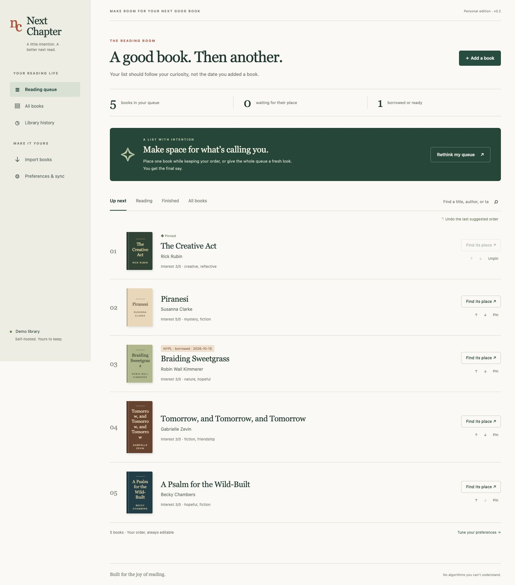

# Next Chapter

A self-hosted reading queue that makes room for a new book where it belongs—not just at the bottom.

Next Chapter is a **single-reader web app** with two ways to organize your list:

- **Find its place:** suggest where one book belongs, preserving the relative order of every other book.
- **Rethink my queue:** reconsider the entire queue using your interest, library timing, preferred length, tags, and series order.

Every suggestion has a preview and reasons. Pinned books keep their positions. You decide whether to apply a suggestion, and can undo it until another library change occurs. No AI service, API key, or subscription is required.



## What works in v0.2

- Add and edit books; move them manually; pin positions; mark reading, finished, abandoned, or archived.
- Explainable placement and full-queue reordering, with preview, stale-preview protection, and undo.
- Goodreads CSV imports and optional hourly public-shelf RSS checks for **new additions**.
- Libby timeline CSV imports and a standard CSV format for physical NYPL activity.
- Separate library events for print, ebook, and audiobook; newest known event wins, regardless of import order.
- Repeatable imports, matching by Goodreads ID, ISBN, then normalized title and author.
- Library-only titles enter **unreviewed**, never automatically finished or added to your reading queue.
- Password login, CSRF protection, local SQLite persistence, JSON export, and consistent SQLite backups.
- Docker, Compose, Kubernetes manifests, automated tests, and tagged multi-platform image publishing.

## Integration boundaries

**This app owns the ordered queue. It does not write order, reading status, ratings, or reviews back to Goodreads.** Goodreads stopped issuing public API keys; this project does not depend on that API or request a Goodreads password.

The optional RSS adapter reads a public shelf. Feeds can be delayed, truncated, unavailable, or changed by Goodreads. Import your full Goodreads CSV first, then enable RSS for new additions. Missing entries in a feed never cause deletions. Feed removals and shelf/status changes are not synchronized. New entries are appended and marked **Needs placement**; suggestions never silently move books. RSS is experimental and requires a real public user ID to validate against your account.

Libby supports exporting timeline activity but does not provide a direct Goodreads integration. Export column names and activity labels can vary. The parser accepts common variants and rejects unsupported rows with an actionable error; normalize those rows to the provided sample CSV before importing. There is no authenticated Libby connection in v0.2.

**NYPL physical history is not a live connection.** The `examples/nypl.csv` format is an app-defined template, not an official NYPL export. Capture current checkouts and holds from your account, or reconstruct records from receipts you already have. NYPL says physical loan records are normally deleted soon after return, so old history cannot be assumed recoverable. An event disappearing from a snapshot is never inferred to be a return or cancellation. No automatic NYPL account or email scraping is included.

Authoritative references:
- [Goodreads API notice](https://www.goodreads.com/group/show/8095-goodreads-developers)
- [Libby export instructions](https://help.libbyapp.com/en-us/6207.htm)
- [Libby / Goodreads integration limitations](https://help.libbyapp.com/en-us/6211.htm)
- [NYPL privacy policy, circulation records](https://www.nypl.org/help/about-nypl/legal-notices/privacy-policy)

## Run with Docker Compose

Requirements: Docker Engine with Compose.

```sh
cp .env.example .env
# Generate two independent secrets and put them in .env:
openssl rand -hex 32
openssl rand -hex 32
# Set APP_PASSWORD to the first value, APP_SECRET_KEY to the second.
docker compose up --build -d
```

Open [localhost:8000](http://localhost:8000) and sign in with `APP_PASSWORD`. Your data is stored in the named `library` volume. Startup fails unless the password is at least 12 characters and the signing key at least 32. `.env` is ignored by Git and excluded from the image.

Compose binds to loopback by default. For access from other devices, place the app behind your HTTPS reverse proxy and set `COOKIE_SECURE=1`, which also sends `Strict-Transport-Security`. Configure the proxy to reach container port 8000 and preserve the host. Keep the app password enabled. Do not publish unauthenticated demo mode.

**Behind a proxy, set `TRUSTED_PROXY_HOPS`.** Failed sign-ins are limited per client address (10 per minute), with a backstop of 100 failures per minute across all clients. By default the client address is the TCP peer and `X-Forwarded-For` is ignored, so it cannot be spoofed. Behind a reverse proxy every request comes from the proxy's address, so all visitors share one limit and one person's typos can lock out everyone for a minute. Set `TRUSTED_PROXY_HOPS` to the number of proxies that append to `X-Forwarded-For` (usually `1`); the app then takes that entry counting from the right, ignoring anything a client prepended. Only set it when every request really passes through that many proxies, or clients can choose their own address.

Sign out on one browser with **Sign out**. **Sign out everywhere** in Preferences ends every session on every device. Changing `APP_PASSWORD` or `APP_SECRET_KEY` also ends every session. When a server error occurs, the page shows a short reference that matches a `request_id=` line in the container log.

The image runs as UID/GID `10001:10001`, with a read-only root filesystem, writable `/tmp`, and persistent `/data`. One Go process serves requests and runs the optional polling goroutine. Use one container/replica per database; SQLite storage should be on a local/block filesystem rather than a shared network filesystem.

### Build or run without Compose

```sh
docker build -t next-chapter:local .
docker run -d --name next-chapter \
  --env-file .env \
  -p 127.0.0.1:8000:8000 \
  -v next-chapter-data:/data \
  --read-only --tmpfs /tmp:mode=1777,size=64m \
  --cap-drop ALL --security-opt no-new-privileges:true \
  next-chapter:local
```

The published Go image is `ghcr.io/lafronzt/next-chapter:0.2.0` (also `:latest`), supporting `linux/amd64` and `linux/arm64`. A release tag triggers the included GitHub workflow. Prefer a version tag or digest in production. The final image contains a statically compiled Go executable and CA certificates, with no interpreter or shell. Rebuild with `docker build --pull` to refresh the Go toolchain.

```sh
docker pull ghcr.io/lafronzt/next-chapter:0.2.0
```

### Upgrade from v0.1

Download a database backup, stop the old container, and start v0.2 with the same data volume and environment settings. The Go version preserves books, queue order, preferences, and borrowing history. It normalizes event timestamps on first startup; pending previews and the last undo are cleared. Sign in again after upgrading. Keep the pre-upgrade backup if you need to roll back to v0.1.

## Kubernetes

Use a cluster with a default StorageClass and a local/block-backed persistent volume. The deployment intentionally uses **one replica** and **Recreate** updates to avoid overlapping SQLite writers/pollers; upgrades have brief downtime.

1. Build and push your image, or publish a release tag with the included GitHub workflow.
2. Replace the image in `deploy/kubernetes/app.yaml` with your registry image and version.
3. Create the secret from the same `.env` file, apply the manifest, and port-forward:

```sh
kubectl create secret generic next-chapter-auth --from-env-file=.env
kubectl apply -f deploy/kubernetes/app.yaml
kubectl port-forward service/next-chapter 8000:80
```

The PVC defaults to 1 GiB. The manifest includes resource limits, readiness/liveness checks, a non-root user, dropped capabilities, and a writable temporary directory. `/healthz` is unauthenticated and returns only a health status.

For an HTTPS Ingress, configure your preferred controller and certificate, then set `COOKIE_SECURE` to `"1"` in the deployment. The example leaves it at `"0"` for HTTP loopback port-forwarding. Avoid setting conflicting values in both the secret and deployment; the explicit deployment value wins.

Kubernetes manifests are supplied as deployment templates. You must choose your storage class, ingress, TLS certificate, namespace, image pull access, and backup destination. No cluster is modified by this repository.

## Ranking behavior

Each queued book starts with `interest × 10` points (10–50). Additional points:

| Signal | Points |
| --- | ---: |
| Ready for pickup | 25 |
| Already borrowed | 15 |
| Available | 5 |
| Loan / pickup deadline within 7 days, including overdue | +20 |
| Exact mood tag match, case-insensitive | 15 |
| Preferred length match (≤250 or ≥400 pages) | 10 |

Only the strongest library signal is used per book; multiple formats do not stack. Library points are multiplied by the selected timing weight (0, 0.5, 1, or 2). All dates used for ranking use UTC. Holds with no pickup date get no timing boost because a request does not imply availability.

Full-queue suggestions sort by score while respecting pins and earlier queued books in the same series. Equal scores preserve existing order. Series metadata is supplied by the reader; Goodreads export/RSS does not reliably provide it. Insertion finds the earliest lower-scoring book, then the closest feasible slot that preserves the other books' order, pin slots, and the candidate's series dependencies. Impossible constraints produce a clear error instead of silently moving pins. Manual moves are intentional overrides of ranking; pin crossings must be unpinned first.

Preferences affect the next suggestion; saving them does not move books. Reading/finished/archived/unreviewed books are outside the queue. Returning a book never changes its reading status.

## Imports and data ownership

CSV files must be UTF-8, ≤2 MB, and ≤10,000 rows. A malformed row blocks the entire import, with row numbers shown. Import previews expire after an hour. A library change invalidates prior previews, preventing an old browser tab from overwriting newer work.

- `Title` and `Author` are required for every record.
- Goodreads fields: `Book Id`, `ISBN13` or `ISBN`, `Number of Pages`, `Exclusive Shelf`, `Bookshelves`.
- Library fields: `Timestamp` (or `Date`), `Activity` (or `Status`), optional `Format`, `ISBN`, and `Due Date`.
- Prefer ISO 8601 timestamps with time zones and `YYYY-MM-DD` due dates. Date-only and timezone-free inputs are treated as UTC. If several different events share the same timestamp and format, the first one imported remains the current status; supply more precise timestamps or log the current status manually to resolve ambiguity.
- Supported activities include Borrowed, Loan, Checked out, Renewed, Hold, Placed on hold, Requested, Ready, Ready for pickup, Returned, Cancelled/Canceled, and Available.
- Use consistent format names (`print`, `ebook`, `audiobook`, or `digital`) across imports. Format names distinguish parallel loans.
- Initial imports use file row order for new books. Existing books keep local reading status, interest, tags, and queue order on subsequent imports; missing identifier/page metadata can be filled in.
- Matching by normalized title + author is conservative about spelling and subtitles. Different titles without a shared identifier may require manual cleanup. Edition-level history is represented through source/format; books are grouped into one reading-list entry when their identifiers/title match.

## Backup and restore

In Preferences, download a **database backup** for full recovery, or JSON for portable readable data. Backups use SQLite’s `VACUUM INTO` snapshot operation, not a potentially incomplete copy of a live WAL file. Pending previews, login-failure counters, and the session key are omitted, so a restored copy never accepts sign-in cookies issued by the original; everyone signs in again after a restore. The backup still contains personal reading history and your public Goodreads connection settings.

To restore:

1. Stop the app and preserve your current volume as a fallback.
2. Use a new empty data volume/directory, put the downloaded backup there as `next-chapter.sqlite3`, and set ownership to `10001:10001`.
3. Point the app at that directory/volume and restart with your existing secret configuration. Keep `APP_SECRET_KEY` stable across normal restarts; changing it signs out existing sessions.

Do not restore over a running database or mix an older database with newer `-wal`/`-shm` files. JSON import/restore is not implemented; use the SQLite backup for recovery.

## Local development

Go 1.27 or later; no frontend build step or C compiler is required:

```sh
go test -race ./...
go vet ./...
go build -trimpath -o ./bin/next-chapter ./cmd/next-chapter
LOCAL_DEMO=1 START_POLLER=0 ./bin/next-chapter
```

Open [localhost:8000](http://localhost:8000). Demo mode has no login and requires a loopback `LISTEN_ADDR` (default `127.0.0.1:8000`). The empty-library page lets you load example books. Production starts with an empty library and never seeds examples.

For production, set `APP_PASSWORD` and `APP_SECRET_KEY` and omit `LOCAL_DEMO`. `DATABASE_PATH` defaults to `data/next-chapter.sqlite3`; `LISTEN_ADDR` defaults to `:8000`. `START_POLLER=0` disables the background checker. `TRUSTED_PROXY_HOPS` (default `0`) is described under Docker Compose. The executable includes `version` and `healthcheck` commands.

The application uses Go’s HTTP server, escaped HTML templates, plain CSS, and a pure-Go SQLite driver. Templates, assets, and CSV examples are embedded in the executable. No font, analytics, cover-image, or AI provider receives reading data. The only outbound app request is opt-in Goodreads RSS.

## Project layout

- `cmd/next-chapter/`: executable, health check, graceful shutdown.
- `internal/app/model.go`: deterministic ranking and constraints.
- `internal/app/imports.go`: CSV/RSS parsing and validation.
- `internal/app/store.go`: schema migration, transactions, matching, event reconciliation, backups.
- `internal/app/sync.go`: fixed-host RSS fetching and optional hourly polling.
- `internal/app/server.go`, `routes.go`: authentication, web routes, previews, exports.
- `internal/app/web/`: embedded templates, assets, and import examples.
- `internal/app/app_test.go`: ranking, import integrity, migration, authentication, and web-flow tests.
- `deploy/kubernetes/`: single-replica persistent deployment.

## Next steps

- Validate import adapters against anonymized real exports from more Libby locales.
- Add an explicit duplicate-merge workflow and editable event corrections.
- Explore opt-in NYPL receipt/email ingestion or an authorized account connector.
- Add optional Goodreads writeback only if a supported integration becomes available.
- Consider multiple reader accounts and PostgreSQL after the personal workflow is proven.

Contributions are welcome under the [MIT license](LICENSE). See [CONTRIBUTING.md](CONTRIBUTING.md) and [SECURITY.md](SECURITY.md).
